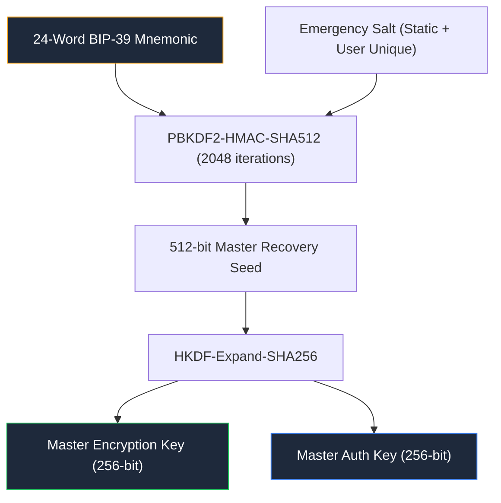
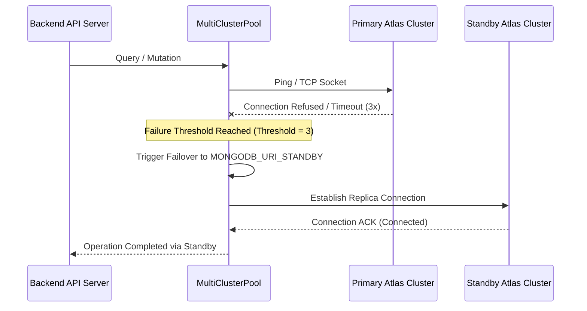

# 🚨 Vault Disaster Recovery & Emergency Operations Manual (`doc/disaster-recovery.md`)

<p align="left">
  <a href="./README.md">← Back to Documentation Hub</a> •
  <a href="#1-recovery-philosophy--trust-boundaries">Philosophy</a> •
  <a href="#2-emergency-vault-recovery-kit-bip-39">Recovery Kit</a> •
  <a href="#3-database-restoration--point-in-time-recovery">Database Restore</a> •
  <a href="#4-multi-cluster-failover-dr-runbook">Cluster Failover</a> •
  <a href="#5-encrypted-backup-export--import">Encrypted Backups</a> •
  <a href="#6-forensic-sanitization--duress-protocol">Duress Sanitization</a>
</p>

This technical runbook details disaster recovery (DR) protocols, offline cryptographic key restoration procedures, and emergency failover mechanisms for the Vault platform.

---

## 1. Recovery Philosophy & Trust Boundaries

Vault is designed under a strict **Zero-Knowledge Architecture**. Consequently:

1. **The Server Cannot Recover Data Alone**: The server maintains only encrypted blobs and cryptographic salts. No operator or administrator can decrypt user vaults without client keys.
2. **Dual-Key Separation**: The authentication secret (derived via Argon2id) grants access to the database record, while the cryptographic encryption key (`MasterEncryptionKey`) decrypts files, notes, and credentials.
3. **Recovery Kits are Sovereign**: The 24-word mnemonic seed is the only mechanism for an end-user to reconstruct their encryption key if their password is forgotten.

---

## 2. Emergency Vault Recovery Kit (BIP-39)

During initial vault provisioning, a 256-bit entropy seed is generated client-side using `crypto.getRandomValues()` and converted into a 24-word BIP-39 English mnemonic.

### 2.1 Key Reconstruction Algorithm



### 2.2 Cold Recovery Procedure

1. Launch Vault in an isolated/offline browser or run the CLI offline recovery tool:
   ```bash
   node scripts/recover-vault.mjs --mnemonic="word1 word2 ... word24"
   ```
2. The recovery utility derives the 256-bit root key and verifies the Sentinel `__keycheck__` string.
3. Upon validation, the user enters a new Master Password; the client re-encrypts the master key envelope and updates the authentication hash on the server.

---

## 3. Database Restoration & Point-in-Time Recovery

### 3.1 Restoring from `vault-production.zip`

Production archives contain encrypted database snapshots and configuration manifests.

1. Verify archive integrity:
   ```powershell
   Get-FileHash -Path "c:\code\vault\vault-production.zip" -Algorithm SHA256
   ```
2. Extract the archive into a staging directory:
   ```powershell
   Expand-Archive -Path "c:\code\vault\vault-production.zip" -DestinationPath "c:\code\vault\vault-tmp\restore"
   ```
3. Execute database seed restoration:
   ```bash
   node scripts/db-restore.mjs --source="c:/code/vault/vault-tmp/restore" --target="$MONGODB_URI"
   ```

### 3.2 MongoDB Atlas Point-in-Time Recovery (PITR)

1. Navigate to the Atlas Console -> **Clusters** -> Select Target Cluster.
2. Under **Backup**, click **Restore Backup** and select **Point-in-Time Restore**.
3. Choose the timestamp immediately preceding the corruption incident.
4. Verify schema collection indexes:
   ```bash
   npm run typecheck:server
   ```

---

## 4. Multi-Cluster Failover DR Runbook

When the primary MongoDB cluster undergoes an unrecoverable outage:



1. **Verify Automatic Failover**: Check `/health` endpoint to inspect `activeClusterNode`.
2. **Force Manual Failover**:
   Update `MONGODB_URI` in `.env` to point directly to the secondary cluster connection string and restart:
   ```bash
   npm run start
   ```

---

## 5. Encrypted Backup Export & Import

Users can export a self-contained, air-gapped `.vbackup` archive containing all vaults encrypted under their master key:

- **Export Format**: Standard JSON container where every record is individually encrypted with `VCAS01` (AES-256-GCM + ChaCha20-Poly1305).
- **Import Verification**:
  1. Header check verifies format magic bytes `VAULT_ENC_v1`.
  2. HMAC signature check ensures zero tamper across transit.
  3. Client decrypts and merges records using conflict-free timestamp comparison.

---

## 6. Forensic Sanitization & Duress Protocol

In coercive or hostile physical custody scenarios:

1. **Trigger Duress PIN**: Enter the predefined Duress PIN on the unlock prompt.
2. **Action Executed**:
   - The client memory is instantly zeroized using `crypto.getRandomValues()`.
   - IndexedDB and `localStorage` sensitive caches are permanently dropped.
   - The UI loads an authentic-looking, benign "Personal Decoy Vault" with innocuous files and notes.
   - Genuine cloud ciphertext remains unreadable without the genuine Master Password.
