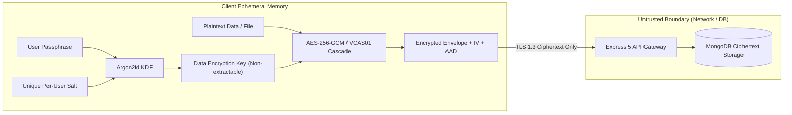
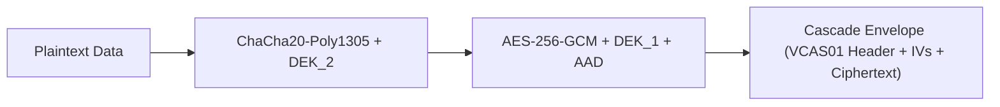
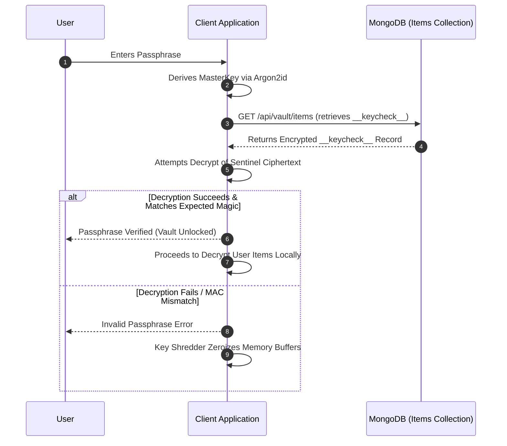

# 🔒 Security & Cryptographic Protocol Specification (`doc/security-and-crypto.md`)

This document provides a technical specification of the security architecture, cryptographic primitives, and multi-tier defense mechanisms engineered into **Vault**.

---

## 1. Zero-Knowledge Cryptographic Model

Vault operates on a strict **Zero-Knowledge Architecture**:

- All plaintext content (notes, passwords, files, metadata, control preferences) is encrypted client-side using authenticated symmetric ciphers.
- The server never possesses, handles, logs, or generates encryption keys.
- If the server database, backups, or communications channels are intercepted, adversaries obtain only indistinguishable pseudo-random ciphertext envelopes.



---

## 2. The 8-Layer Cryptographic Security Protocol

Vault implements a defense-in-depth model structured across eight verification layers:

```
+-----------------------------------------------------------------------------------+
|  Layer 1: Key Derivation (KDF)        - Argon2id (64MB RAM, 3 iter, 4 lanes)      |
|  Layer 2: Post-Quantum Key Exchange    - X25519 + Kyber-768 ML-KEM Hybrid Bridge   |
|  Layer 3: Payload & Cascade Encryption - VCAS01 Dual Cascade (AES-GCM + ChaCha20) |
|  Layer 4: Zero-Knowledge E2EE         - RSA-OAEP 2048/4096 + TLS 1.3 Transport    |
|  Layer 5: Device Integrity & Signature- SHA-256 Fingerprint + Ed25519 Signatures  |
|  Layer 6: Ephemeral RAM Protection    - 60s Inactivity Key Shredder & Zeroization |
|  Layer 7: Key Isolation & Duress      - Non-Extractable CryptoKey + Decoy PIN     |
|  Layer 8: Multi-Factor & Lockout      - WebAuthn Passkeys + TOTP + reCAPTCHA Bot  |
+-----------------------------------------------------------------------------------+
```

---

### Layer 1: Key Derivation Function (Argon2id)

The user's master encryption key is derived using **Argon2id** (RFC 9106), executed via Web Worker offloading (`hash-wasm`) to prevent UI freezes:

- **Memory Cost (`m_cost`)**: `65536 KB` (64 MB)
- **Time Iterations (`t_cost`)**: `3 iterations`
- **Parallelism (`p_cost`)**: `4 lanes`
- **Derived Output Length**: `256 bits` (32 bytes)
- **Salt Generation**: High-entropy 128-bit cryptographically secure pseudorandom salt (`crypto.getRandomValues`), uniquely bound to the user identifier.
- **PBKDF2 Fallback**: Supported for legacy client migration using HMAC-SHA256 with 600,000 rounds.

```typescript
// Key derivation parameters (src/lib/encryption.ts)
export const SECURITY_CONSTANTS = {
  AES_GCM_IV_LENGTH: 12,
  ARGON2_MEMORY: 65536,
  ARGON2_ITERATIONS: 3,
  ARGON2_PARALLELISM: 4,
  ARGON2_HASH_LENGTH: 32,
  KEY_BYTE_LENGTH: 32,
  RSA_MODULUS_LENGTH: 2048,
  RSA_ALGORITHM: 'RSA-OAEP',
  RSA_HASH: 'SHA-256',
} as const;
```

---

### Layer 2: Post-Quantum Hybrid Key Exchange (X25519 + Kyber-768)

To protect confidential records against **Harvest Now, Decrypt Later (HNDL)** quantum adversaries, Vault integrates a hybrid post-quantum key exchange protocol:

1. **Classical Component**: Curve25519 Elliptic Curve Diffie-Hellman (`X25519`).
2. **Post-Quantum Component**: Lattice-based Module Lattice Key Encapsulation Mechanism (**ML-KEM / Kyber-768**, NIST FIPS 203).
3. **Hybrid Combination**: The shared secret is derived through a dual-source HKDF combiner:
   $$\text{SharedSecret} = \text{HKDF-Extract}(\text{ECDH\_Secret} \mathbin{\Vert} \text{Kyber\_SharedSecret})$$
   This guarantees that even if a cryptographically relevant quantum computer breaks discrete logarithms, security remains completely preserved by the lattice problem.

---

### Layer 3: Payload & Cascade Envelope Encryption (`VCAS01`)

Payloads can be encrypted with authenticated **AES-256-GCM** or the high-security **`VCAS01` Multi-Cipher Cascade**:

#### Standard AES-256-GCM Envelope

- **Cipher**: AES-256 in Galois/Counter Mode (NIST SP 800-38D).
- **IV Length**: 96-bit (12 bytes) fresh, random IV per record.
- **Authentication Tag**: 128-bit authentication tag validating ciphertext integrity.
- **Additional Authenticated Data (AAD)**: Context-bound user and item IDs bound as AAD to prevent ciphertext splicing across records or accounts.

#### Dual Cascade Encryption (`VCAS01`)

For ultra-critical records, data is sequentially encrypted through two independent cipher algorithms using distinct 32-byte Data Encryption Keys:

1. **Outer Cipher**: Authenticated **AES-256-GCM**.
2. **Inner Cipher**: Authenticated **ChaCha20-Poly1305** (RFC 8439).
3. **Magic Header**: Marked with 4-byte identifier `0x56434153` (`VCAS01`).



---

### Layer 4: Zero-Knowledge E2EE & Transport Boundary

- **Asymmetric Envelope Encryption**: RSA-OAEP with 2048/4096-bit keys and SHA-256 digest allows secure device-to-device sharing without revealing master keys.
- **Transport Hardening**: Strict TLS 1.3 PFS enforcement, HTTP Strict Transport Security (HSTS) with 1-year max-age and preload directive.
- **Helmet Headers**: Comprehensive Content Security Policy (CSP), Cross-Origin Resource Policy (CORP), Frameguard (`DENY`), and `X-Content-Type-Options: nosniff`.

---

### Layer 5: Device Integrity & Digital Signatures

- **Hardware & Browser Fingerprinting**: High-entropy device signature computed using browser features and canvas entropy, bound to the session via `X-Fingerprint-Id`.
- **Digital Signatures**: Critical account mutations and device revocation requests are digitally signed using **libsodium Ed25519** asymmetric keys generated locally on the authenticated device.

---

### Layer 6: Ephemeral RAM Protection & Key Shredder

To mitigate cold-boot attacks, malicious browser extensions, and memory dumps:

1. **Non-Extractable CryptoKeys**: Derived keys are imported into the browser WebCrypto subsystem with `extractable: false`, preventing scripts from extracting the raw key bytes.
2. **60-Second Inactivity Shredder**: An active background watchdog monitors user interactions (mouse, keyboard, touch). If 60 seconds elapse with zero activity, all in-memory keys, cache records, and temporary buffers are purged.
3. **Explicit Memory Zeroization**: Typed arrays containing sensitive key fragments are zero-filled using `.fill(0)` immediately upon completion of cryptographic operations.

---

### Layer 7: Key Isolation & Duress Decoy PIN Partition

- **Decoy Workspace**: Vault supports configuring a secondary **Decoy PIN**.
- **Plausible Deniability**: Under physical or coercive duress, entering the Decoy PIN seamlessly unlocks an authentic-looking, isolated secondary partition containing realistic mock items.
- **Cryptographic Independence**: The decoy partition uses an entirely distinct salt and derived key. There is zero cryptographic metadata or database schema indication that a primary vault exists.

---

### Layer 8: Multi-Factor & Brute-Force Bot Defense

- **Passkeys (FIDO2 / WebAuthn)**: Biometric hardware-backed authentication (Face ID, Touch ID, Windows Hello, YubiKey) resistant to phishing and credential stuffing.
- **Time-Based One-Time Password (TOTP)**: RFC 6238 compliant 6-digit TOTP generator and authenticator with QR code provisioning and rate-limited verification.
- **reCAPTCHA v2 / v3 Bot Defense**: Backend middleware (`recaptchaMiddleware`) guards registration, authentication, and password verification against automated brute-force attacks.
- **Emergency Lockout**: Successive failed authentication attempts trigger exponential backoff and progressive lockout periods.

---

## 3. Sentinel Verification Protocol (`__keycheck__`)

How does Vault verify that the user entered the correct passphrase without decrypting true data or exposing credentials to the server?



The sentinel contains a known cryptographic token (`MAGIC_SENTINEL_TOKEN`). If AES-GCM decryption fails authentication tag validation, the master key is immediately purged from RAM without touching user files.

---

## 4. Merkle Tree Tamper Detection

Vault maintains a hierarchical **Merkle Tree** across all encrypted user records:

- Each item's ciphertext, timestamp, and metadata form a leaf hash:
  $$\text{Leaf}_i = \text{SHA-256}(\text{ItemID} \mathbin{\Vert} \text{Ciphertext} \mathbin{\Vert} \text{UpdatedAt})$$
- Merkle root hash is updated on every mutation and checked upon client sync.
- If a silent bit-flip, database corruption, or unauthorized database manipulation occurs on the server, the root hash immediately mismatches, triggering a client-side security alarm and preventing corrupted writes from overwriting local storage.
