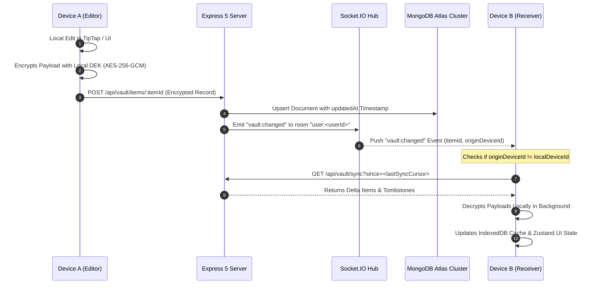
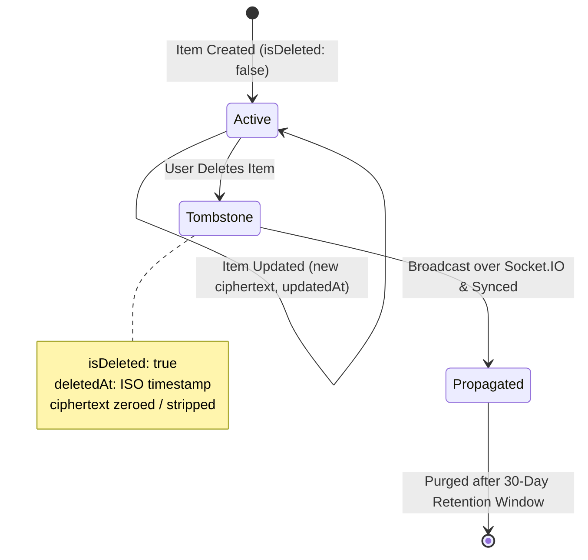
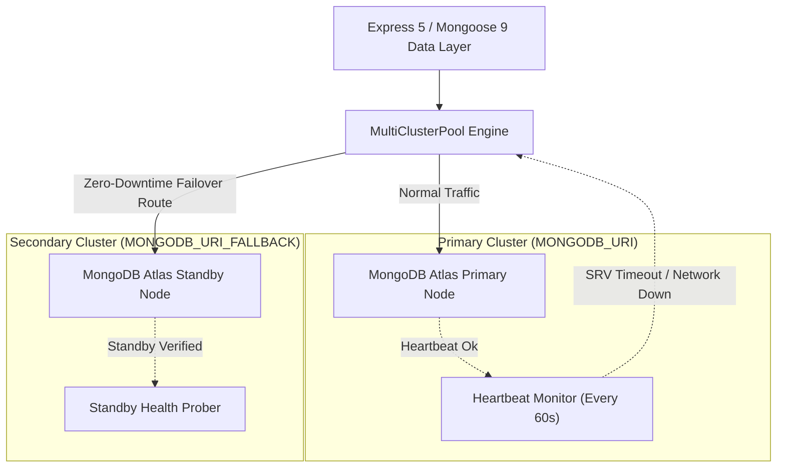

# 🔄 Real-Time Synchronization & Storage Architecture (`doc/sync-and-storage.md`)

This document describes how **Vault** manages multi-device synchronization, offline support, conflict resolution, and high-availability database failover.

---

## 1. Dual-Pipeline Synchronization Architecture

Vault employs a hybrid synchronization architecture combining low-latency WebSocket push notifications with resilient HTTP delta polling:



---

## 2. Synchronization Strategies & Protocols

### 2.1 Incremental Delta Querying (`/api/vault/sync`)

- Instead of downloading the full vault on every change, clients maintain an integer or ISO timestamp sync cursor (`lastSyncCursor`).
- Queries pass `?since=<lastSyncCursor>`.
- The database returns only records where `updatedAt > since` or `deletedAt > since`.
- Reduces network payload size by over **98%** in active multi-device workflows.

### 2.2 Offline-First Design & Local Caching

- **Client Cache**: The client persists decrypted records into browser-sandboxed **IndexedDB** (`idb`), keyed by user ID.
- **Offline Mutations**: When offline, edits are queued in an outbound sync queue.
- **Reconnection Flush**: Upon network restoration, the queue flushes sequentially, updating remote records and requesting delta reconciliation.

---

## 3. Conflict Resolution & Arbitration

When two devices edit the same record concurrently without synchronization:

### 3.1 Deterministic Timestamp Arbitration (`latest-update-wins`)

- Every record mutation carries a millisecond-precision UTC ISO timestamp generated during local encryption (`updatedAt`).
- If concurrent edits arrive at the server:
  - If incoming `updatedAt > existingRecord.updatedAt`, the incoming update is accepted.
  - If incoming `updatedAt <= existingRecord.updatedAt`, the update is preserved as a concurrent revision or rejected, depending on client configuration.

### 3.2 Merkle Tree Tamper Detection

- Vault calculates an in-memory Merkle tree of record hashes on the client.
- If an out-of-order write or accidental database rollback occurs, the Merkle root hash calculated by the client diverges from the server's state hash.
- The client prompts the user to inspect differences rather than silently corrupting local state.

---

## 4. Tombstone Deletion Lifecycle

In distributed zero-knowledge systems, hard-deleting database records causes problems: an offline device reconnecting later would simply re-upload the deleted item.

Vault uses **Tombstones**:



1. **Soft Delete**: When a user deletes an item, `DELETE /api/vault/items/:id` sets:
   - `isDeleted: true`
   - `deletedAt: <currentTimestamp>`
   - Ciphertext payload is stripped to minimize storage overhead.
2. **Sync Propagation**: The tombstone is returned in delta sync responses, instructing peer devices to remove the item from local storage.
3. **Retention & Pruning**: After 30 days, a background maintenance worker purges tombstone records permanently.

---

## 5. Storage Tier & Multi-Cluster Database Failover

Vault relies on MongoDB Atlas for encrypted metadata, control records, and item envelopes, backed by `multiClusterPool.ts`.



### 5.1 Failover Engine Specifications (`server/services/multiClusterPool.ts`)

- **Dual SRV URIs**: Configured with `MONGODB_URI` and `MONGODB_URI_FALLBACK`.
- **DNS Lookup Resilience**: Primary DNS lookups query Cloudflare (`1.1.1.1`) and Google (`8.8.8.8`). If DNS resolution fails, fallback resolvers are automatically rotated.
- **Direct Connection Option**: In restricted cloud container networks where SRV lookups fail, `MONGODB_URI_DIRECT` provides a non-SRV replica set connection string.
- **Failover Trigger Criteria**:
  - 3 consecutive connection timeouts (>5000ms).
  - Unhandled replica set election freeze.
  - Heartbeat failure during `atlas-keepalive.mjs` background cycles.

---

## 6. Encrypted File Storage on Disk

Large binary assets (videos, high-resolution photos, raw documents) are stored on disk under the persistent `uploads/` directory:

1. **Storage Layout**:
   ```text
   uploads/
   ├── <userId>/
   │   ├── <fileId>.bin        # Client-encrypted binary ciphertext
   │   ├── <fileId>.meta       # File envelope metadata (size, mime, iv)
   │   └── chunks/             # Temporary staging for active TUS/Multipart uploads
   ```
2. **Chunk Assembly**: Resumable TUS and multipart uploads stream chunks into staging subdirectories. Once all parts are present, they are atomically merged, validated via SHA-256, and promoted to permanent storage.
3. **Streaming Decryption**: During playback, the server streams encrypted byte ranges to the client. The client WebCrypto worker streams chunks into an in-memory decryption pipeline, piping plaintext video frames straight to the HTML5 video element.
