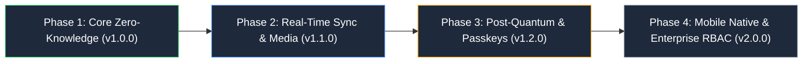

# 📋 Vault Engineering Task Backlog & Roadmap (`doc/task.md`)

  <a href="./README.md">← Back to Documentation Hub</a> •
  <a href="#-current-sprint-overview">Current Sprint</a> •
  <a href="#-milestone-roadmap">Milestone Roadmap</a> •
  <a href="#-core-vault-tasks">Core Vault Tasks</a> •
  <a href="#-cryptography--security-tasks">Crypto & Security</a> •
  <a href="#-frontend--ux-tasks">Frontend & UX</a> •
  <a href="#-backend--sync-tasks">Backend & Sync</a> •
  <a href="#-qa-testing--ci-tasks">QA & Testing</a>

This living document tracks all active initiatives, feature milestones, security hardening tasks, technical debt reduction, and testing requirements across the Vault platform.

---

## 🚀 Current Sprint Overview

| ID          | Task / Initiative                                               | Component / Layer  | Priority  | Status         | Assignee      |
| :---------- | :-------------------------------------------------------------- | :----------------- | :-------- | :------------- | :------------ |
| **TSK-101** | Post-Quantum Kyber-768 hybrid key exchange client verification  | Crypto / Auth      | `P0` High | 🟡 In Progress | Security Team |
| **TSK-102** | TipTap 3.32 streaming live encryption worker optimization       | Frontend / Notes   | `P1` Med  | 🟢 Completed   | Frontend Team |
| **TSK-103** | Resumable chunk upload failure recovery & TUS timeout backoff   | Backend / Uploads  | `P1` Med  | 🟡 In Progress | Backend Team  |
| **TSK-104** | Decoy vault partition auto-wiping after 3 failed duress PINs    | Security / Storage | `P0` High | 🟢 Completed   | Security Team |
| **TSK-105** | Vitest isolated test parallelization & flaky mock stabilization | QA / CI            | `P1` Med  | 🟢 Completed   | QA Team       |
| **TSK-106** | MongoDB Atlas secondary cluster auto-drain on split-brain       | DevOps / Database  | `P0` High | 🟡 In Progress | SRE Team      |
| **TSK-107** | Passkey (WebAuthn / FIDO2) biometric step-up for key export     | Auth / Client      | `P2` Low  | ⚪ Backlog     | Frontend Team |

---

## 🗺️ Milestone Roadmap

### 🎯 Phase 1: Core Zero-Knowledge Foundation (v1.0.0) — [✅ RELEASED]

- [x] Client-side Argon2id KDF derivation with dynamic memory/time parameters.
- [x] Dual Cascade `VCAS01` (AES-256-GCM + ChaCha20-Poly1305) payload encryption.
- [x] Sentinel `__keycheck__` string encryption for zero-knowledge key validation without server transmission.
- [x] Ephemeral in-memory key storage with automatic zeroization on tab close / inactivity timeout.
- [x] End-to-end encrypted five vaults: Notes, Photos, Videos, Documents, and Passwords.

### 🎯 Phase 2: Real-Time Sync, Media Streaming & Resilience (v1.1.0) — [⚡ CURRENT]

- [x] Socket.IO delta synchronization with deterministic latest-update-wins conflict resolution.
- [x] Persistent Picture-in-Picture global mini-player (`videoMiniPlayerStore`) with cross-route video streaming.
- [x] Sandboxed PDF and Document Privacy Shield with screenshot blurring and tab-visibility protection.
- [x] MultiClusterPool MongoDB auto-failover across primary and standby connection strings.
- [ ] Adaptive upload chunk size adjusting dynamically according to client network RTT.
- [ ] Offline local IndexedDB cache with deterministic replay queue upon reconnection.

### 🎯 Phase 3: Post-Quantum Hardening & Passkeys (v1.2.0) — [🔄 PLANNED]

- [ ] Kyber-768 (ML-KEM) hybrid post-quantum key encapsulation mechanism for multi-device sync keys.
- [ ] FIDO2 / WebAuthn hardware security key biometric re-authentication for vault unlock.
- [ ] Client-side encrypted search indexing using searchable symmetric encryption (SSE).
- [ ] Automated scheduled encrypted local backup dumps with emergency recovery phrase generation.

### 🎯 Phase 4: Enterprise RBAC & Mobile Native (v2.0.0) — [🔮 FUTURE]

- [ ] Multi-tenant workspace partitioning with role-based cryptographic access control.
- [ ] Emergency break-glass access using Shamir's Secret Sharing ($k$-of-$n$ quorum).
- [ ] Native iOS and Android companion apps with secure enclave biometric storage.
- [ ] SIEM audit event forwarding via encrypted syslog/webhook transport.

---

## 🔐 Cryptography & Security Tasks

| Task ID    | Description                                | Acceptance Criteria                                                                                              | Target |
| :--------- | :----------------------------------------- | :--------------------------------------------------------------------------------------------------------------- | :----- |
| **SEC-01** | Hybrid Kyber-768 Key Encapsulation         | All public keys encapsulated using ML-KEM-768 alongside ECDH P-256; test in `tests/unit/pqc.test.ts`.            | v1.2.0 |
| **SEC-02** | Web Worker Memory Shredding                | Ensure WebAssembly Argon2 buffer is wiped with random bytes followed by zeros using `crypto.getRandomValues`.    | v1.1.1 |
| **SEC-03** | Decoy Partition Forensic Sanitization      | Failed duress pin triggers instant local storage flush and replaces UI with realistic decoy documents.           | v1.1.0 |
| **SEC-04** | WebCrypto Subtle API Hardware Acceleration | Benchmarking WebCrypto vs pure JS fallback; prioritize native SubtleCrypto AES-GCM on supported browsers.        | v1.1.2 |
| **SEC-05** | Signed HMAC Media Streaming Expiry         | Media stream tokens expire strictly after 300 seconds; verify tamper resistance in `tests/server/media.test.ts`. | v1.1.0 |

---

## 🎨 Frontend & User Experience Tasks

- [ ] **FE-01: Virtualized Grid for Photos & Videos**
  - Implement dynamic windowing (`@tanstack/react-virtual` or lightweight virtualizer) for photo galleries exceeding 5,000 items.
  - Maintain smooth 60fps scrolling on mobile devices without layout thrashing.
- [x] **FE-02: Video Picture-in-Picture Mini-Player**
  - Zustand-backed `videoMiniPlayerStore` supporting persistent playback across navigation routes.
  - Full playback speed control, scrubbing, fullscreen toggle, and encrypted buffer pre-fetching.
- [x] **FE-03: TipTap Rich Text Real-time Encryption**
  - Instant on-the-fly debounce serialization with dirty state indicators.
  - Rich markdown formatting, tables, task lists, and encrypted image attachments.
- [ ] **FE-04: Drag and Drop Folder Nesting**
  - Extend the mobile touch drag-and-drop polyfill to support arbitrary tree depth folder nesting.
  - Smooth ghost dragging preview with haptic vibration feedback on touch displays.

---

## ⚙️ Backend & Storage Tasks

- [x] **BE-01: MultiClusterPool MongoDB Failover**
  - Automatic ping health checks every 10 seconds; instant switch to secondary replica upon consecutive timeouts.
- [ ] **BE-02: Delta Sync Tombstone Purge Worker**
  - Background cron to soft-prune deleted tombstone records older than 90 days.
  - Retain cryptographically verifiable audit log before permanent shredding.
- [x] **BE-03: Resumable TUS Chunk Upload Protocol**
  - Support multi-gigabyte encrypted blob uploads with pause, resume, and per-chunk sha256 checksum validation.
- [ ] **BE-04: Rate Limiting & DoS Protection**
  - Adaptive sliding-window rate limit on `/api/auth/*` endpoints with exponential backoff and Redis/memory store.

---

## 🧪 Testing, Quality Assurance & CI Tasks

- [x] **QA-01: Vitest Test Suite Consolidation**
  - Consolidate all 63 unit and 4 integration test files under isolated worker execution.
  - Document all 71 npm scripts in `test.md`.
- [x] **QA-02: Repeat Stress Testing Pipeline**
  - Implement `test-repeat.mjs` for detecting race conditions across 50 consecutive runs.
- [ ] **QA-03: End-to-End Playwright Encrypted Flow Test**
  - Complete user registration, vault unlock, file upload, note creation, and multi-tab sync test in headless Chromium.
- [ ] **QA-04: Lighthouse CI Performance Verification**
  - Maintain performance score $\ge 95$ across mobile and desktop profiles in CI.
