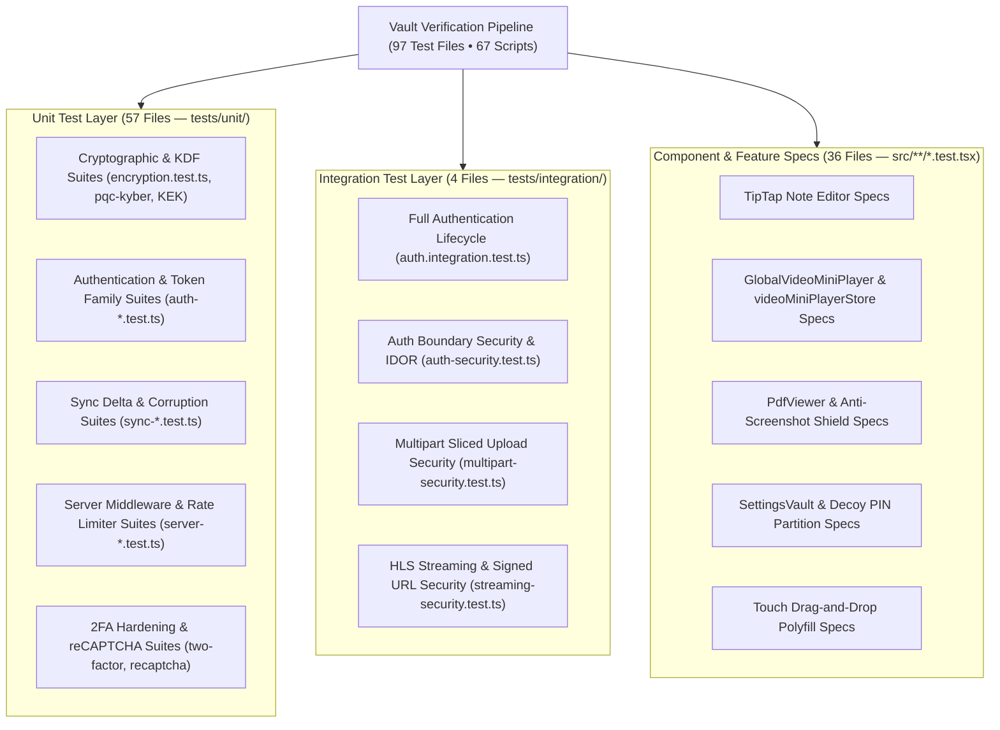

# 🧪 Testing, Quality Assurance & Verification Architecture (`doc/testing-and-verification.md`)

This document details the test methodology, test execution pipelines, mock architectures, and CI/CD verification harnesses implemented across **Vault**.

---

## 1. Testing Suite Architecture & Scope

Vault enforces a rigorous quality and security verification pipeline consisting of **97 automated test files** and **67 specialized npm test scripts** executed via **Vitest 5.0**:



---

## 2. Test Execution & NPM Script Reference

Vault provides purpose-built npm scripts for developers, security auditors, and CI/CD pipelines:

### 2.1 Core Execution Commands

| Command                          | Mode / Execution Profile           | Purpose                                                              |
| :------------------------------- | :--------------------------------- | :------------------------------------------------------------------- |
| **`npm test`**                   | Single Worker (`--maxWorkers 1`)   | Default safe test run minimizing resource contention.                |
| **`npm run test:run`**           | Multi-Core Parallel                | Fast full test run across all CPU workers.                           |
| **`npm run test:ci`**            | Lint + No-Cache Vitest             | Strict deterministic test run executed in GitHub Actions.            |
| **`npm run test:fast`**          | Bail on First Failure (`--bail=1`) | Immediate feedback loop during rapid development.                    |
| **`npm run test:ui`**            | Interactive Web Dashboard          | Launches the Vitest visual browser interface with live watch graphs. |
| **`npm run test:coverage:open`** | Coverage Report                    | Generates V8 code coverage report and opens HTML summary in browser. |

### 2.2 Security & Domain Test Suites

| Domain                    | Dedicated Command       | Target Files & Scenarios                                                        |
| :------------------------ | :---------------------- | :------------------------------------------------------------------------------ |
| **Cryptography**          | `npm run test:crypto`   | AES-256-GCM, Argon2id, Kyber-768 ML-KEM, `VCAS01` cascade, sentinel check.      |
| **Authentication**        | `npm run test:auth`     | Login, register, token family tracking, refresh rotation, session revocation.   |
| **Security Perimeters**   | `npm run test:security` | CSRF protection, IP rate throttling, reCAPTCHA bot defense, multipart abuse.    |
| **Cloud Synchronization** | `npm run test:sync`     | Delta sync cursor, conflict arbitration, soft-delete tombstones, store mirrors. |
| **Media & Streaming**     | `npm run test:media`    | HLS video player, chunk streaming, camera capture modal, signed URL HMACs.      |
| **Mini-Player (PiP)**     | `npx vitest run ...`    | Floating Picture-in-Picture state persistence across routes and folders.        |
| **Mobile PDF Shield**     | `npx vitest run ...`    | Anti-screenshot watermark, tab-switch 30px blur mask, print prevention.         |

---

## 3. Cryptographic & Async Mock Architectures

Because Vault relies heavily on native browser WebCrypto, Web Workers, and WebSockets, the test suite implements isolated mock drivers:

### 3.1 WebCrypto API Polyfill (`tests/setup.ts`)

- In Node.js testing environments, `crypto.subtle` is mapped to Node's native `webcrypto.subtle`.
- Key handles generate with genuine hardware entropy; AES-256-GCM authentications execute true Galois field multiplications.

### 3.2 Argon2id Web Worker Mocking

- The Argon2id Web Worker bridge (`hash-wasm`) is intercepted in unit tests via a deterministic synchronous or async driver to allow ultra-fast test runs (<10ms per KDF derivation during unit testing).
- Production Argon2id parameters (`64MB RAM, 3 iterations`) are verified in dedicated cryptographic stress tests.

### 3.3 Socket.IO In-Memory Server Mock

- Real-time sync tests spin up an in-memory HTTP server and Socket.IO client instances.
- Verifies that `vault:changed` events broadcast exclusively to the authenticated user's isolated room (`user:<userId>`) and never leak to peer sockets.

---

## 4. Stress Testing & Race Condition Detection

Vault includes an automated stress-testing runner (`scripts/test-repeat.mjs`):

```bash
# Run the entire test suite 5 times sequentially to detect race conditions
npm run test:repeat 5
```

### Flaky Test Detection:

- Runs high-concurrency sync and multipart upload operations in repeat loops.
- Validates that concurrent cross-device mutations resolve cleanly without deadlocks or unhandled Promise rejections.

---

## 5. Performance Auditing (Lighthouse CI & Code Memory)

Beyond unit and integration tests, Vault enforces performance and health gates:

1. **Project Health Doctor (`scripts/doctor.mjs`)**:
   ```bash
   npm run doctor
   ```
   Validates Node.js engine compatibility, TypeScript configurations, environment secrets, and toolchain integrity before builds.
2. **Lighthouse CI Performance Runner (`scripts/lighthouse-runner.mjs`)**:
   ```bash
   npm run lighthouse:ci
   ```
   Asserts minimum Lighthouse scores: Accessibility $\ge 90$, Best Practices $\ge 90$, SEO $\ge 90$, Performance $\ge 65$.
3. **Code Memory Indexer (`scripts/code-memory-index.mjs`)**:
   ```bash
   npm run memory:all
   ```
   Generates architectural complexity heatmaps, dependency graph visualizers, and code risk indices stored under `.memory/`.
