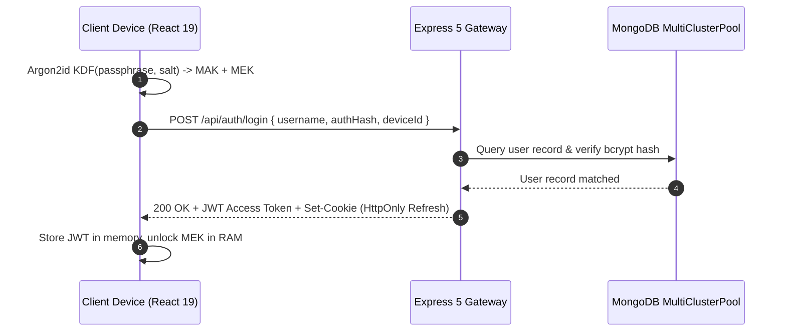

# 🔌 REST API & WebSocket Protocol Contract Specification (`doc/API.md`)

**Specification Standard**: OpenAPI 3.0 / REST & AsyncAPI Compatible  
**API Version**: `v1`  
**Base URL (Production)**: `https://my-vault-cic6.onrender.com/api`  
**Base URL (Development)**: `http://localhost:4000/api`  
**WebSocket Gateway**: `wss://my-vault-cic6.onrender.com/socket.io`

---

## 1. Global Security, Headers & Protocol Standards

### 1.1 Authentication Headers

All protected API endpoints require an authenticated JSON Web Token passed in the `Authorization` HTTP header:

```http
Authorization: Bearer <access_token>
```

### 1.2 Mandatory Security Headers

Every HTTP response from the Vault API gateway includes the following defense-in-depth headers:

| Header Name                    | Configured Value                                                                                                                | Security Purpose                                              |
| :----------------------------- | :------------------------------------------------------------------------------------------------------------------------------ | :------------------------------------------------------------ |
| `Content-Security-Policy`      | `default-src 'self'; script-src 'self'; style-src 'self' 'unsafe-inline'; img-src 'self' data: blob:; connect-src 'self' wss:;` | Prevents XSS, script injection, and rogue outbound telemetry. |
| `Cross-Origin-Resource-Policy` | `same-origin`                                                                                                                   | Blocks cross-origin asset leakage.                            |
| `Strict-Transport-Security`    | `max-age=31536000; includeSubDomains; preload`                                                                                  | Enforces TLS 1.3 across all connections.                      |
| `X-Content-Type-Options`       | `nosniff`                                                                                                                       | Prevents MIME-sniffing attacks.                               |
| `X-Frame-Options`              | `DENY`                                                                                                                          | Prevents UI redressing and clickjacking attacks.              |
| `X-XSS-Protection`             | `1; mode=block`                                                                                                                 | Legacy browser reflection defense.                            |

### 1.3 Standard Response Formats

#### Successful Response Envelope (`2xx`):

```json
{
  "success": true,
  "data": { ... },
  "message": "Operation completed successfully.",
  "timestamp": "2026-10-25T01:00:00.000Z"
}
```

#### Error Response Envelope (`4xx` / `5xx`):

```json
{
  "success": false,
  "error": {
    "code": "INVALID_CREDENTIALS",
    "message": "Authentication failed. Verification token does not match.",
    "details": null
  },
  "timestamp": "2026-10-25T01:00:00.000Z"
}
```

---

## 2. Authentication & Session Services (`/api/auth`)



### 2.1 Register New Account

- **Endpoint**: `POST /api/auth/register`
- **Rate Limit**: 10 requests / 15 minutes per IP
- **Description**: Creates a new user record with zero-knowledge salt, post-quantum salt, and device session.

#### Request Schema:

```json
{
  "username": "string (min 3, max 32, alphanumeric + underscores)",
  "password": "string (min 8 chars, hashed client-side AuthKey)",
  "masterKey": "string (Base64 encrypted Sentinel token __keycheck__)",
  "deviceId": "string (UUID v4 client device identifier)",
  "recaptchaToken": "string (optional reCAPTCHA verification token)"
}
```

#### Response (201 Created):

```json
{
  "success": true,
  "data": {
    "token": "eyJhbGciOiJIUzI1NiIsInR5cCI6IkpXVCJ9...",
    "user": {
      "id": "65f0a82bc194d30a11223344",
      "username": "alice",
      "pqcSalt": "b78a9c40...",
      "twoFactorEnabled": false
    }
  }
}
```

### 2.2 User Login

- **Endpoint**: `POST /api/auth/login`
- **Rate Limit**: 5 failed attempts / 15 minutes per IP (triggers exponential backoff)
- **Description**: Verifies credentials, registers active device session, and sets rotating HTTP-Only cookie.

#### Request Schema:

```json
{
  "username": "alice",
  "password": "ClientHashedMasterAuthKey",
  "deviceId": "c8a91b40-9d0a-482f-8935-71bbd3c10a45",
  "recaptchaToken": "03AFcWeA..."
}
```

#### Response (200 OK):

```json
{
  "success": true,
  "data": {
    "token": "eyJhbGciOiJIUzI1NiIsInR5cCI6IkpXVCJ9...",
    "user": {
      "id": "65f0a82bc194d30a11223344",
      "username": "alice",
      "pqcSalt": "b78a9c40...",
      "twoFactorEnabled": false
    }
  }
}
```

_Response Header_: `Set-Cookie: refreshToken=...; Path=/api/auth; HttpOnly; Secure; SameSite=Strict; Max-Age=2592000`

### 2.3 Token Refresh (Session Rotation)

- **Endpoint**: `POST /api/auth/refresh`
- **Description**: Consumes the HTTP-Only refresh token cookie, rotates the token family, and delivers a fresh access JWT.

#### Response (200 OK):

```json
{
  "success": true,
  "data": {
    "token": "eyJhbGciOiJIUzI1NiIsInR5cCI6IkpXVCJ9..."
  }
}
```

### 2.4 Logout & Session Invalidation

- **Endpoint**: `POST /api/auth/logout`
- **Description**: Invalidates the active session token in the database and clears the refresh cookie.

---

## 3. Two-Factor & Passkey Services (`/api/auth/2fa`, `/api/auth/passkey`)

### 3.1 Setup TOTP Two-Factor

- **Endpoint**: `POST /api/auth/2fa/generate`
- **Auth**: Bearer Token
- **Description**: Generates a standard RFC 6238 TOTP secret and QR code URI.

#### Response (200 OK):

```json
{
  "success": true,
  "data": {
    "qrCodeUrl": "otpauth://totp/Vault:alice?secret=JBSWY3DPEHPK3PXP&issuer=Vault",
    "secret": "JBSWY3DPEHPK3PXP",
    "backupCodes": ["1a2b-3c4d", "5e6f-7a8b", "9c0d-1e2f", "3a4b-5c6d"]
  }
}
```

### 3.2 Verify & Activate TOTP

- **Endpoint**: `POST /api/auth/2fa/verify`
- **Auth**: Bearer Token
- **Request Body**: `{ "token": "123456" }`

---

## 4. Encrypted Vault Storage & Sync Services (`/api/vault`)

```mermaid
flowchart LR
    Client["Client Local Store (Zustand + IDB)"]
    API["/api/vault/items"]
    Sync["/api/vault/sync?since=timestamp"]
    Socket["Socket.IO room: user:userId"]

    Client -->|1. Encrypted Upsert (VCAS01)| API
    Client -->|2. Delta Query| Sync
    API -.->|3. Real-Time Broadcast| Socket
    Socket -.->|4. Push Notification| Client
```

### 4.1 Fetch All Encrypted Items

- **Endpoint**: `GET /api/vault/items`
- **Auth**: Bearer Token
- **Description**: Returns all encrypted items for the user across all 14 vault compartments.

#### Response (200 OK):

```json
{
  "success": true,
  "data": [
    {
      "id": "67b93190-67a8-48b2-b5e1-7c98027d14ac",
      "type": "note",
      "category": "personal",
      "ciphertext": "U2FsdGVkX1+...==",
      "iv": "3f82a9b401c2",
      "tag": "e91b4028fa01726c",
      "version": 4,
      "updatedAt": "2026-10-24T18:30:00.000Z"
    }
  ]
}
```

### 4.2 Upsert Encrypted Vault Item

- **Endpoint**: `POST /api/vault/items/:itemId`
- **Auth**: Bearer Token
- **Request Body**:

```json
{
  "type": "note | photo | video | audio | document | password | secret | card | contact | identity | wifi | location | todo | chat | file",
  "category": "string (optional category identifier)",
  "ciphertext": "string (Base64-encoded encrypted envelope)",
  "iv": "string (Base64-encoded 96-bit IV)",
  "tag": "string (Base64-encoded 128-bit authentication tag)",
  "metadata": {
    "size": 1048576,
    "mimeType": "application/pdf"
  },
  "clientTimestamp": "2026-10-25T01:10:00.000Z"
}
```

### 4.3 Soft Delete Vault Item (Tombstone)

- **Endpoint**: `DELETE /api/vault/items/:itemId`
- **Auth**: Bearer Token
- **Description**: Sets `isDeleted: true` and broadcasts a tombstone event to all authenticated user sessions.

### 4.4 Incremental Delta Sync Query

- **Endpoint**: `GET /api/vault/sync?since=<iso8601_timestamp>`
- **Auth**: Bearer Token
- **Description**: Fetches items created, modified, or soft-deleted since the specified timestamp.

#### Response (200 OK):

```json
{
  "success": true,
  "data": {
    "items": [ ... ],
    "tombstones": [
      {
        "id": "67b93190-67a8-48b2-b5e1-7c98027d14ac",
        "deletedAt": "2026-10-25T01:05:00.000Z"
      }
    ],
    "serverTime": "2026-10-25T01:15:00.000Z"
  }
}
```

---

## 5. Resumable & Chunked Upload Services (`/api/vault/upload`)

Vault implements dual upload mechanisms for reliable transmission over mobile and unstable networks:

### 5.1 Resumable TUS Upload Protocol

Complies with the official [TUS 1.0.0 Resumable Upload Protocol](https://tus.io/protocols/resumable-upload.html).

| Method   | Endpoint                          | Headers / Payload                                                           | Description                                                                        |
| :------- | :-------------------------------- | :-------------------------------------------------------------------------- | :--------------------------------------------------------------------------------- |
| `POST`   | `/api/vault/upload/tus`           | `Upload-Length: 52428800`<br>`Upload-Metadata: filename dGVzdC5tcDQ=...`    | Creates a new upload session; returns `Location: /api/vault/upload/tus/:uploadId`. |
| `HEAD`   | `/api/vault/upload/tus/:uploadId` | None                                                                        | Returns `Upload-Offset` and `Upload-Length` to check progress.                     |
| `PATCH`  | `/api/vault/upload/tus/:uploadId` | `Upload-Offset: 1048576`<br>`Content-Type: application/offset+octet-stream` | Streams binary chunk starting from `Upload-Offset`.                                |
| `DELETE` | `/api/vault/upload/tus/:uploadId` | None                                                                        | Terminates upload session and purges temporary disk buffers.                       |

### 5.2 Multipart Sliced Upload Protocol

Alternative chunked upload protocol using discrete HTTP PUT requests:

- `POST /api/vault/upload/multipart/start`: Initializes multipart session.
- `PUT /api/vault/upload/multipart/:uploadId/part/:partNumber`: Streams chunk with MD5 checksum header.
- `POST /api/vault/upload/multipart/:uploadId/complete`: Triggers server-side chunk concatenation and SHA-256 verification.

---

## 6. Encrypted Media Streaming Services (`/api/vault/media`)

### 6.1 Generate Signed Stream Token

- **Endpoint**: `POST /api/vault/media/signed-url`
- **Auth**: Bearer Token
- **Request Body**:

```json
{
  "fileId": "media-uuid",
  "expiresInSeconds": 300
}
```

- **Response**: Returns signed token URL: `/api/vault/media/:fileId/stream?token=HMAC_SHA256_TOKEN`

### 6.2 Stream Encrypted Media Chunk

- **Endpoint**: `GET /api/vault/media/:fileId/stream?token=<token>`
- **Headers Supported**: `Range: bytes=0-1048575`
- **Status Codes**: `200 OK` (Full) or `206 Partial Content` (Range stream).

---

## 7. Real-Time WebSocket Protocol Specifications

The real-time layer connects via Socket.IO on namespace `/socket.io`.

### 7.1 Client Connection Handshake

```javascript
import { io } from 'socket.io-client';

const socket = io('https://my-vault-cic6.onrender.com', {
  auth: {
    token: `Bearer ${jwtToken}`,
  },
  transports: ['websocket', 'polling'],
});
```

### 7.2 Event Catalog

| Event Name        | Direction                       | Payload Schema                                                                | Action / Purpose                                                                                                  |
| :---------------- | :------------------------------ | :---------------------------------------------------------------------------- | :---------------------------------------------------------------------------------------------------------------- |
| `vault:changed`   | Server $\rightarrow$ Client     | `{ itemId: string, type: string, updatedAt: string, originDeviceId: string }` | Notifies clients that an item was created or updated. If `originDeviceId !== localDeviceId`, triggers delta sync. |
| `vault:deleted`   | Server $\rightarrow$ Client     | `{ itemId: string, deletedAt: string, originDeviceId: string }`               | Soft-deletion tombstone; removes item from client store.                                                          |
| `session:revoked` | Server $\rightarrow$ Client     | `{ deviceId: string, timestamp: string }`                                     | Remote session termination; if target is local device, triggers RAM zeroization and logout.                       |
| `sync:conflict`   | Server $\rightarrow$ Client     | `{ itemId: string, localVersion: number, remoteVersion: number }`             | Triggers timestamp arbitration on client.                                                                         |
| `heartbeat`       | Client $\leftrightarrow$ Server | `{ ping: number }`                                                            | Measures Round-Trip Time (RTT) and connection health.                                                             |

---

## 8. HTTP Error Code Reference

| HTTP Code | Error Code Identifier         | Typical Cause & Resolution                                        |
| :-------- | :---------------------------- | :---------------------------------------------------------------- |
| `400`     | `INVALID_PAYLOAD`             | Request body failed schema validation. Check required fields.     |
| `401`     | `UNAUTHORIZED`                | Bearer token missing, expired, or malformed.                      |
| `403`     | `CSRF_MISMATCH` / `FORBIDDEN` | Missing HMAC CSRF token or account status locked.                 |
| `404`     | `ITEM_NOT_FOUND`              | Target vault item or upload session does not exist.               |
| `409`     | `CONFLICT`                    | Concurrent modification on item; requires delta refresh.          |
| `413`     | `PAYLOAD_TOO_LARGE`           | File exceeds maximum allowable threshold (500MB).                 |
| `429`     | `RATE_LIMIT_EXCEEDED`         | Exceeded route rate limit threshold. Check `Retry-After` header.  |
| `500`     | `INTERNAL_SERVER_ERROR`       | Unexpected backend condition. Details logged to Sentry/SystemLog. |
| `503`     | `SERVICE_UNAVAILABLE`         | MultiClusterPool failover in progress. Retry in 1-2 seconds.      |
