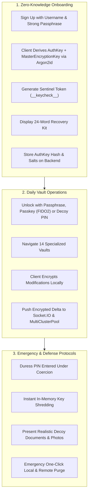
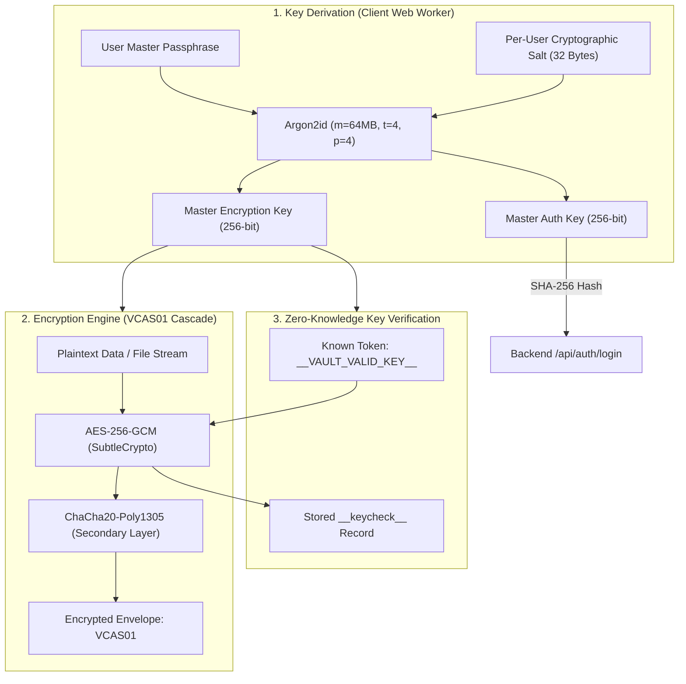
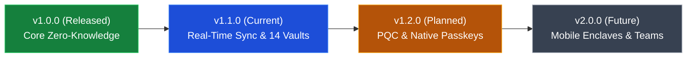

# 📄 Product Requirements Document (PRD) — Vault

**Document Version**: 2.0.0  
**Status**: Approved & Baselined  
**Classification**: Technical Product Specification  
**Target Platform**: Web (React 19 / Vite / PWA), Responsive Mobile, Desktop Browsers

---

## 1. Executive Summary & Vision

### 1.1 Product Mission

**Vault** is an enterprise-grade, zero-knowledge personal storage and real-time synchronization ecosystem designed to safeguard high-value personal data, media, confidential documents, cryptographic keys, and credentials. Unlike legacy cloud storage providers that maintain server-side decryption keys, Vault guarantees mathematical zero-knowledge privacy: **all cryptographic keys are generated and retained exclusively in client device memory**, ensuring that neither server operators, cloud infrastructure hosts, nor network eavesdroppers can ever read user data.

### 1.2 Core Value Propositions

1. **Mathematical Zero-Knowledge Privacy**: Data is encrypted using client-side **AES-256-GCM** or **`VCAS01` Dual-Cipher Cascade (AES-256-GCM + ChaCha20-Poly1305)** prior to any network transit or cloud persistence.
2. **Unified 14-Compartment Vault Architecture**: Consolidates separate point tools (password managers, photo vaults, secure note apps, document lockers, crypto seed stores, encrypted chats, task managers, and Wi-Fi keychains) into a single cohesive, hardened workspace.
3. **Sub-50ms Real-Time Multi-Device Sync**: Bidirectional event propagation powered by **Socket.IO** rooms with deterministic timestamp arbitration (`latest-update-wins`) and soft-delete tombstone tracking.
4. **Resilient Hybrid Cloud Storage**: Dual upload pipelines featuring **TUS Resumable Streaming** and **Multipart Chunked Uploads** paired with automatic **MongoDB Atlas MultiClusterPool failover**.
5. **Physical Coercion & Duress Defense**: A decoy partition unlocked via an alternate PIN that silently purges primary encryption keys from RAM and presents plausible decoy data under hostile inspection.
6. **Future-Proof Quantum Hardening**: Hybrid integration of post-quantum **Kyber-768 (ML-KEM, NIST FIPS 203)** alongside classical ECDH to protect against _Harvest Now, Decrypt Later (HNDL)_ threats.

---

## 2. Target Personas & User Journeys

### 2.1 Target Personas

- **Privacy-Conscious Individuals & Families**: Everyday users seeking absolute confidentiality for family photos, health records, identity documents, and financial records away from big-tech ad tracking.
- **Investigative Journalists & Human Rights Advocates**: High-risk operators working in hostile jurisdictions requiring verifiable zero-knowledge guarantees, anti-screenshot shields, tab-switch masking, and duress decoy modes.
- **Software Engineers & Crypto Operators**: Power users managing BIP-39 mnemonic seed phrases, private SSH/PGP keys, cloud API secrets, database credentials, and server configurations.
- **Enterprise Executives & Legal Counsel**: Business professionals reviewing highly sensitive M&A documents, client contracts, and board communications under strict confidentiality.

### 2.2 Core User Journeys



---

## 3. Product Scope: The 14 Specialized Vault Modules

Vault provides 14 purpose-built encrypted modules, each engineered with specialized data models, UI components, and cryptographic flows:

```
+-----------------------------------------------------------------------------------------+
|                                🏛️ VAULT ECOSYSTEM MODULES                               |
+-----------------------------------------------------------------------------------------+
|  1. 📝 Notes Vault       - TipTap 3.32 rich-text editor, live Markdown, table support   |
|  2. 📷 Media Vault       - Photos/videos, EXIF stripper, HLS streaming, PiP mini-player |
|  3. 🎵 Audio Vault       - Encrypted voice memos, visual waveform analyzer, audio player|
|  4. 📄 Documents Vault   - PDF Privacy Shield, anti-screenshot mask, tab-blur guard     |
|  5. 🔑 Password Manager  - Passwords, OTP tokens, zxcvbn strength scoring, leak checks  |
|  6. 🗝️ Secrets Vault     - BIP-39 mnemonic seeds, API tokens, Kyber-768 key pairs       |
|  7. 💳 Cards Vault       - Credit & debit cards, Luhn checksum validation, CVV masking  |
|  8. 👤 Contacts Vault    - Encrypted address book, avatars, notes, vCard export         |
|  9. 🆔 Identities Vault  - Passports, national IDs, driver licenses, scan attachments  |
| 10. 📶 Wi-Fi Vault       - Network SSIDs, passwords, encryption modes, QR generators    |
| 11. 📍 Location Vault    - Coordinates, addresses, interactive map pins, travel notes   |
| 12. ✅ Todo Vault        - Checklists, priorities, deadline alerts, encrypted subtasks  |
| 13. 💬 Chat Vault        - Private encrypted messages, self-destruct timers, media clips|
| 14. 📁 Other Files Vault - Arbitrary binary storage, bulk upload, MIME validation      |
+-----------------------------------------------------------------------------------------+
```

### 3.1 Notes Vault (`NotesVault.tsx`)

- **Editor Engine**: Headless **TipTap 3.32** built on ProseMirror.
- **Rich Formatting**: Markdown auto-formatting (`#`, `**`, `> `, `- [ ]`), tables with cell manipulation, inline highlight, blockquotes, code blocks with syntax highlighting.
- **Autosave & Encryption**: Debounced 300ms autosave triggering client-side Web Worker encryption. Zero plaintext touches disk or network.

### 3.2 Media Vault (`MediaVault.tsx`)

- **Format Support**: JPEG, PNG, WebP, GIF, MP4, MOV, WebM.
- **Privacy Stripping**: Automatic client-side EXIF/geolocation metadata stripping before cipher operations.
- **Global Video Mini-Player**: Persistent floating Picture-in-Picture window (`videoMiniPlayerStore`) backed by Zustand, allowing continuous encrypted video playback across route navigation with brightness/contrast filters and speed controls.
- **Encrypted Streaming**: Signed HMAC URLs with HLS chunking for smooth playback without full-file pre-buffering.

### 3.3 Audio Vault (`AudioVault.tsx`)

- **Voice Recording**: In-browser encrypted voice memos via Web Audio API and MediaRecorder.
- **Waveform Visualizer**: Live canvas-rendered audio frequency visualizer during playback and recording.
- **Playback Controls**: Variable playback rate (0.5x to 2.0x), waveform seeking, loop, and encrypted tag classification.

### 3.4 Documents & PDF Shield (`DocumentsVault.tsx`, `PdfViewer.tsx`)

- **Privacy Shield Engine**: Instant 30px CSS Gaussian blur masking triggered on `window.onblur` and `document.visibilityState === 'hidden'` to prevent OS preview snapshotting.
- **Screenshot & Print Suppression**: Intercepts `Ctrl+P`, `Cmd+P`, and `PrintScreen` keystrokes; injects print-media CSS clearing DOM content during print calls.
- **Dynamic Identity Watermark**: Diagonal floating watermark with authenticated username, timestamp, and device fingerprint.

### 3.5 Password Manager (`PasswordManager.tsx`)

- **Credential Storage**: URL, username, encrypted password, TOTP seed, and custom encrypted notes.
- **Password Generator**: Cryptographically secure entropy engine with customizable length, symbols, digits, and mnemonic passphrases.
- **Security Analytics**: Real-time **zxcvbn** password strength scoring and HaveIBeenPwned k-anonymity breach verification (sending only 5-character SHA-1 prefixes).

### 3.6 Secrets & Recovery Vault (`SecretsVault.tsx`)

- **Seed Phrase Management**: BIP-39 standard 12, 18, and 24-word recovery phrase generator and validator with checksum verification.
- **Cryptographic Keys**: Dedicated fields for SSH private keys, PGP keys, cloud API secrets, and Post-Quantum Kyber-768 key pairs.
- **One-Click Masking**: Field-level hide/reveal toggles with 5-second automatic re-masking timeouts.

### 3.7 Payment Cards Vault (`CardsVault.tsx`)

- **Card Formats**: Visa, Mastercard, American Express, Discover, JCB, and generic bank cards.
- **Validation**: Client-side **Luhn algorithm** verification with instant card issuer detection and color-coded card renderers.
- **Security Masking**: Card numbers and CVVs are masked by default with clipboard auto-wipe after 30 seconds.

### 3.8 Contacts Vault (`ContactsVault.tsx`)

- **Data Models**: Names, phone numbers, encrypted email addresses, physical addresses, relationship tags, and notes.
- **Import/Export**: Encrypted backup and standard vCard (`.vcf`) export.

### 3.9 Identities Vault (`IdentitiesVault.tsx`)

- **Identity Templates**: Passports, national identification cards, driver licenses, social security numbers, and residence permits.
- **Document Scans**: Multi-page encrypted image attachments for front and back identity verification cards.

### 3.10 Wi-Fi Vault (`WifiVault.tsx`)

- **Credentials**: Network SSID, security type (WPA3-Personal, WPA2-Personal, WEP, Open), and password.
- **Instant Connect QR Code**: Dynamic QR code generation enabling mobile cameras to join networks without manual password entry.

### 3.11 Location Vault (`LocationVault.tsx`)

- **Coordinates & Addresses**: Lat/long coordinate storage, formatted addresses, altitude, and private notes.
- **Map Navigation**: Direct launch links into privacy-respecting navigation tools (OpenStreetMap, Apple Maps, Google Maps).

### 3.12 Todo & Tasks Vault (`TodoVault.tsx`)

- **Task Organization**: Categorized task lists with priority indicators (Urgent, High, Medium, Low), deadlines, and tags.
- **Security Verification**: Fully covered with dedicated unit and security test suites ensuring task payloads are never stored in plaintext.

### 3.13 Chat Vault (`ChatVault.tsx`)

- **Encrypted Messaging**: Private messaging threads between authenticated devices or designated participants.
- **Ephemeral Timers**: Configurable message burn-after-reading timers (1 hour, 24 hours, 7 days).

### 3.14 Other Files Vault (`OtherFilesVault.tsx`)

- **Universal Storage**: Handles arbitrary encrypted files (ZIP archives, raw binaries, proprietary formats) up to 500MB per file.
- **Chunked Processing**: Drag-and-drop zone with client-side SHA-256 calculation and parallel slice uploading.

---

## 4. Cryptographic & Security Architecture Requirements



### 4.1 Key Derivation Parameters (Argon2id)

- **Algorithm**: Argon2id via WebAssembly (`hash-wasm`).
- **Memory Cost**: $65,536\text{ KiB}$ ($64\text{ MB}$).
- **Time Iterations**: $t = 4$.
- **Parallelism**: $p = 4$.
- **Derivation Output**: 512 bits split into 256-bit `MasterEncryptionKey (MEK)` and 256-bit `MasterAuthKey (MAK)`.

### 4.2 Dual-Cipher Cascade (`VCAS01`)

- **Outer Layer**: ChaCha20-Poly1305 with independent 96-bit nonce.
- **Inner Layer**: AES-256-GCM with independent 96-bit IV and 128-bit authentication tag.
- **Defense Profile**: Protects against any future theoretical compromise of single-cipher primitives or side-channel timing attacks.

### 4.3 Post-Quantum Cryptography (ML-KEM-768 / Kyber-768)

- **Standard**: NIST FIPS 203 ML-KEM-768.
- **Application**: Hybrid encapsulation for cross-device synchronization and long-term archive keys to neutralize Harvest Now, Decrypt Later (HNDL) attacks.

### 4.4 Inactivity Shredding & RAM Security

- **Inactivity Timer**: Automatic vault lock and memory shredding after 60 seconds of user inactivity.
- **Key Zeroization**: Cryptographic key buffers are overwritten with random bytes followed by zeros (`crypto.getRandomValues`) before garbage collection.

### 4.5 Duress Partition & Emergency Wipe

- **Duress PIN Activation**: If a secondary Duress PIN is supplied at the login prompt:
  1. Primary keys in memory are instantly purged.
  2. The UI renders a realistic decoy vault pre-populated with synthetic documents, photos, and notes.
  3. No error or notification is displayed that would alert an inspecting adversary.
- **Panic Self-Destruct**: User-initiated emergency button instantly wipes local IndexedDB caches, active sessions, and optionally issues an authenticated remote wipe request.

---

## 5. Non-Functional Requirements (NFR)

| Category                  | Requirement Specification                                                                                                                                                                                                                                                    |
| :------------------------ | :--------------------------------------------------------------------------------------------------------------------------------------------------------------------------------------------------------------------------------------------------------------------------- |
| **Performance**           | • Client-side encryption throughput > 25 MB/s on modern hardware.<br>• Sub-300ms First Contentful Paint (FCP) and < 1.2s Largest Contentful Paint (LCP).<br>• Real-time WebSocket event latency < 50ms under median network conditions.                                      |
| **Availability**          | • 99.9% uptime target backed by automatic MongoDB Atlas MultiClusterPool failover.<br>• Resumable chunked file uploads survive intermittent mobile disconnects without data loss.                                                                                            |
| **Security & Compliance** | • Zero-Knowledge trust boundary verified via automated integration security suites.<br>• Content-Security-Policy (CSP), HSTS, X-Frame-Options DENY, and double-submit HMAC CSRF guards.<br>• WebAuthn / FIDO2 hardware passkeys and RFC 6238 TOTP two-factor authentication. |
| **Scalability**           | • Static pre-compression pipeline with Brotli (`.br`) and Gzip (`.gz`) delivery.<br>• Optimized 17-chunk vendor code splitting ensuring modular asset streaming.                                                                                                             |
| **Browser Compatibility** | • Full support for modern evergreen browsers: Chrome/Chromium 120+, Firefox 120+, Safari 17+, Edge 120+.<br>• Progressive Web App (PWA) offline asset caching.                                                                                                               |

---

## 6. Release Milestones & Product Roadmap



- **v1.0.0 (Core Zero-Knowledge Foundation)**: Client-side Argon2id derivation, AES-256-GCM, Sentinel validation, initial Notes, Media, and Password vaults.
- **v1.1.0 (Current Baseline)**: Complete 14-compartment vault ecosystem, TipTap 3.32 rich-text editor, Global Video Mini-Player (PiP), PDF Privacy Shield, TUS resumable uploads, Socket.IO real-time delta sync, MongoDB Atlas MultiClusterPool failover.
- **v1.2.0 (Post-Quantum & Hardware Keys)**: Production Kyber-768 ML-KEM key exchange, FIDO2 biometric step-up, client-side encrypted search indexing.
- **v2.0.0 (Enterprise & Native Apps)**: Shamir's Secret Sharing ($k$-of-$n$ recovery quorum), iOS/Android native secure enclaves, multi-tenant encrypted team workspaces.
