# 📚 Vault Master Technical Documentation Hub (`doc/README.md`)

Welcome to the comprehensive technical documentation and architectural reference for **Vault** — an enterprise-grade, zero-knowledge personal storage and real-time cloud synchronization platform.

---

## 🗂️ Complete Documentation Directory Index

This `doc/` folder contains comprehensive architectural specifications, cryptographic protocol analyses, API guides, threat models, database blueprints, performance optimization strategies, engineering task tracking, disaster recovery runbooks, troubleshooting manuals, and deployment guides. All documentation reflects the exact implementation details of the Vault codebase.

| Document                                                                     | Primary Architectural Focus & Contents                                                                                                                                                                                                                                                                                   |
| :--------------------------------------------------------------------------- | :----------------------------------------------------------------------------------------------------------------------------------------------------------------------------------------------------------------------------------------------------------------------------------------------------------------------- |
| [**`PRD.md`**](./PRD.md)                                                     | **Product Requirements Document (PRD)** Comprehensive product vision, personas, detailed functional specifications for all 14 specialized vault compartments, non-functional requirements, and release milestones.                                                                                                    |
| [**`DESIGN.md`**](./DESIGN.md)                                               | **System Architecture & Design Blueprint** High-level system topology, Zero-Knowledge trust boundary, Dual-Key separation, Frontend (React 19) & Backend (Express 5) architectures, MultiClusterPool failover engine, and static pre-compression delivery.                                                            |
| [**`security-and-crypto.md`**](./security-and-crypto.md)                     | **8-Layer Cryptographic Protocol & Security Specification** Deep dive into Argon2id KDF, Post-Quantum Kyber-768 ML-KEM, Dual Cascade `VCAS01` (AES-256-GCM + ChaCha20-Poly1305), Sentinel `__keycheck__` algorithm, Merkle tree tamper detection, RAM key zeroization, duress decoy partition, and WebAuthn passkeys. |
| [**`API.md`**](./API.md)                                                     | **REST API & WebSocket Contract Specification (OpenAPI 3.0 Compatible)** Exhaustive REST API contracts, headers, request/response JSON schemas, rate limits, error catalog, and Socket.IO real-time event schemas.                                                                                                    |
| [**`api-reference.md`**](./api-reference.md)                                 | **Complete REST API & WebSocket Protocol Reference** Authentication & session rotation (`/api/auth/*`), Vault CRUD and delta sync (`/api/vault/*`), Resumable TUS and multipart chunk uploads, encrypted media streaming with signed HMAC URLs, and Socket.IO real-time event schemas.                                |
| [**`audit-report.md`**](./audit-report.md)                                   | **Project Architecture, Security & Code Quality Audit Report** Comprehensive verification of code cleanliness, test coverage metrics (97 test suites, 67 npm scripts), cryptographic zero-knowledge proofs, and static analysis scorecard.                                                                            |
| [**`database-schemas.md`**](./database-schemas.md)                           | **Database Data Models & Schema Architecture** Field-by-field reference for Mongoose models (`User`, `fileItemSchema`, `noteSchema`, `passwordSchema`, `secretKeySchema`, `sessionSchema`, `loginHistorySchema`), compound indexing strategies, and soft-delete tombstone tracking.                                   |
| [**`threat-model.md`**](./threat-model.md)                                   | **STRIDE Threat Model & Cryptographic Risk Analysis** Formal analysis against Spoofing, Tampering, Repudiation, Information Disclosure, Denial of Service, and Elevation of Privilege; cold-boot RAM dump defenses, coercive duress mitigation, and anti-screenshot shields.                                          |
| [**`sync-and-storage.md`**](./sync-and-storage.md)                           | **Real-Time Sync, Conflict Resolution & Storage Architecture** Dual-pipeline synchronization (Socket.IO + delta polling), deterministic latest-update-wins arbitration, soft-delete tombstones lifecycle, multi-cluster MongoDB Atlas automatic failover, and encrypted disk storage.                                 |
| [**`client-features.md`**](./client-features.md)                             | **Frontend Architecture & Client Features** Architecture for all 14 specialized vaults, TipTap 3.32 rich text editor, Global Video Mini-Player (Picture-in-Picture) backed by Zustand, Sandboxed PDF & Document Privacy Shield, Audio waveform visualizer, and touch drag-and-drop polyfill.                          |
| [**`task.md`**](./task.md)                                                   | **Vault Engineering Task Backlog & Roadmap** Active sprint tracking, milestone roadmaps (v1.0.0 through v2.0.0), security hardening tasks, frontend/backend backlogs, and QA testing tasks.                                                                                                                           |
| [**`testing-and-verification.md`**](./testing-and-verification.md)           | **Testing, Quality Assurance & Verification Architecture** Deep dive into the 97-file Vitest test suite, 67 npm test scripts, WebCrypto/Argon2id mocks, repeat stress testing (`test-repeat.mjs`), and Lighthouse CI performance auditing.                                                                            |
| [**`performance.md`**](./performance.md)                                     | **Performance, Asset Optimization & Benchmarking** Build-time 17-chunk code splitting, Brotli & Gzip pre-compression, immutable caching hierarchies, Web Worker KDF offloading, and Core Web Vitals targets with Lighthouse CI gates.                                                                                 |
| [**`setup-and-deployment.md`**](./setup-and-deployment.md)                   | **Setup, Configuration & Production Deployment Guide** Quick-start local setup, complete `.env` environment variables catalog, production build and pre-compression pipeline, Render cloud deployment, health checks, and test suite navigation.                                                                      |
| [**`troubleshooting.md`**](./troubleshooting.md)                             | **Troubleshooting & Incident Resolution Manual** Diagnostic workflows, root-cause analyses, and instant fixes for client-side cryptographic errors, Sentinel keycheck failures, session revocation loops, MongoDB cluster timeouts, and TUS upload drops.                                                             |
| [**`disaster-recovery.md`**](./disaster-recovery.md)                         | **Disaster Recovery & Emergency Operations Manual** BIP-39 24-word recovery kit reconstruction, multi-cluster database failover runbooks, point-in-time restores from production archives, encrypted backups, and duress sanitization protocols.                                                                      |
| [**`architecture-decision-records.md`**](./architecture-decision-records.md) | **Architecture Decision Records (ADRs)** Architectural decision log covering Zero-Knowledge Dual-Key architecture, VCAS01 cascade ciphers, Post-Quantum Kyber-768 ML-KEM, Socket.IO delta sync, TipTap streaming encryption, and duress decoy partitions.                                                             |
| [**`user-guide.md`**](./user-guide.md)                                       | **User-Friendly Handbook & Everyday Guide** Plain-English walkthrough for everyday users: Account setup, Zero-Knowledge rules, all 14 specialized vaults, touch drag & drop, decoy vault, shortcuts, and FAQs.                                                                                                        |

---

## 🧭 Role-Based Reading Paths

Depending on your role and objectives, explore the following recommended paths:

```mermaid
flowchart TD
    Role["Choose Your Role"]

    Role --> Arch["System Architect / Reviewer"]
    Role --> Sec["Security Engineer / Auditor"]
    Role --> Dev["Frontend / Backend Developer"]
    Role --> Ops["DevOps / SRE / Cloud Engineer"]
    Role --> QA["QA / Test Engineer"]
    Role --> User["Everyday User / Privacy Seeker"]

    Arch -->|1. High Level| D["DESIGN.md"]
    Arch -->|2. Requirements| PRD["PRD.md"]
    Arch -->|3. Data Flow| S["sync-and-storage.md"]
    Arch -->|4. Database| DB["database-schemas.md"]

    Sec -->|1. Crypto Details| C["security-and-crypto.md"]
    Sec -->|2. Threat Modeling| T["threat-model.md"]
    Sec -->|3. Audit Report| AR["audit-report.md"]
    Sec -->|4. Trust Boundary| D

    Dev -->|1. Setup| Set["setup-and-deployment.md"]
    Dev -->|2. API Contracts| API["API.md"]
    Dev -->|3. Performance| P["performance.md"]
    Dev -->|4. UI Modules| F["client-features.md"]
    Dev -->|5. Schemas| DB

    Ops -->|1. Deployment| Set
    Ops -->|2. Performance| P
    Ops -->|3. Failover Pool| S
    Ops -->|4. Threat Vectors| T

    QA -->|1. Test Architecture| QA_Doc["testing-and-verification.md"]
    QA -->|2. Test Manual| TM["../test.md"]
    QA -->|3. API Endpoints| API

    User -->|1. Plain-English Guide| U["user-guide.md"]
```

### 1. 🏛️ System Architects & Reviewers

1. Read [**`PRD.md`**](./PRD.md) for complete functional requirements, persona definitions, and product guarantees.
2. Read [**`DESIGN.md`**](./DESIGN.md) for the end-to-end component topology, zero-trust enclaves, and micro-service structures.
3. Review [**`architecture-decision-records.md`**](./architecture-decision-records.md) for rationale on zero-knowledge dual-keys, cascade ciphers, and post-quantum choices.
4. Read [**`sync-and-storage.md`**](./sync-and-storage.md) to understand distributed multi-device event routing and multi-cluster database resilience.
5. Review [**`database-schemas.md`**](./database-schemas.md) for data isolation and document modeling.

### 2. 🛡️ Security Engineers & Compliance Auditors

1. Read [**`security-and-crypto.md`**](./security-and-crypto.md) for the 8-layer cryptographic specifications, Argon2id parameters, Post-Quantum Kyber-768 lattice mechanisms, and `VCAS01` cascade ciphers.
2. Review [**`audit-report.md`**](./audit-report.md) for comprehensive verification of cryptographic hygiene, zero-knowledge proofs, and test results.
3. Read [**`threat-model.md`**](./threat-model.md) for formal STRIDE evaluations, memory shredding proofs, and duress decoy partitions.
4. Review [**`disaster-recovery.md`**](./disaster-recovery.md) for BIP-39 recovery procedures and forensic duress sanitization.
5. Review [**`database-schemas.md`**](./database-schemas.md) to verify that no plaintext passwords, master keys, or personal payloads exist in database collections.

### 3. 💻 Full-Stack & Frontend Developers

1. Start with [**`task.md`**](./task.md) to check current sprint goals, open backlogs, and priority items.
2. Start with [**`setup-and-deployment.md`**](./setup-and-deployment.md) to initialize your environment.
3. Review [**`API.md`**](./API.md) and [**`api-reference.md`**](./api-reference.md) for REST route parameters, payload schemas, and Socket.IO real-time channels.
4. Keep [**`troubleshooting.md`**](./troubleshooting.md) open for diagnostic workflows and quick resolutions.
5. Read [**`performance.md`**](./performance.md) for chunk splitting, Brotli pre-compression, and Web Worker offload architectures.
6. Review [**`client-features.md`**](./client-features.md) for architecture of all 14 specialized vaults, TipTap editor integration, the persistent Picture-in-Picture video store (`videoMiniPlayerStore`), and the mobile touch drag-and-drop polyfill.

### 4. 🚀 DevOps & SRE Engineers

1. Follow [**`setup-and-deployment.md`**](./setup-and-deployment.md) for environment configuration and Render production deployment.
2. Read [**`disaster-recovery.md`**](./disaster-recovery.md) for multi-cluster database failover runbooks and point-in-time recovery.
3. Keep [**`troubleshooting.md`**](./troubleshooting.md) handy for cluster outages, TUS upload failures, and connection pool degradation.
4. Read [**`performance.md`**](./performance.md) for static asset streaming and Core Web Vitals CI gates.
5. Study the `MultiClusterPool` automatic failover configuration and DNS retries in [**`sync-and-storage.md`**](./sync-and-storage.md).

### 5. 🧪 QA & Test Engineers

1. Review [**`task.md`**](./task.md) for sprint test deliverables and open quality assurance backlog items.
2. Consult [**`testing-and-verification.md`**](./testing-and-verification.md) to understand test isolation, WebCrypto mocks, and repeat stress testing loops.
3. Refer to root [**`test.md`**](../test.md) for individual test commands, debug flags, and full npm script tables.

### 6. 👤 Everyday Users & Privacy Enthusiasts

1. Read [**`user-guide.md`**](./user-guide.md) for a plain-English guide on account setup, the 14 specialized vaults, shortcuts, decoy partition setup, and common FAQs.

---

## 🔗 Related Repository Resources

- [**Root `README.md`**](../README.md): Project overview, live deployment badges, quick start, and architecture summary.
- [**Test Suite Manual (`test.md`)**](../test.md): Complete testing cheat sheet covering 97 test files and 67 npm test scripts.
- [**Docker Guide (`DOCKER.md`)**](../DOCKER.md): Containerization, multi-stage Dockerfile build, and Docker Compose orchestration.
- [**Contribution Guidelines (`CONTRIBUTING.md`)**](../CONTRIBUTING.md): Code standards, commit formatting, and pull request workflows.
- [**Changelog (`CHANGELOG.md`)**](../CHANGELOG.md): Historical record of major releases and security patches.
