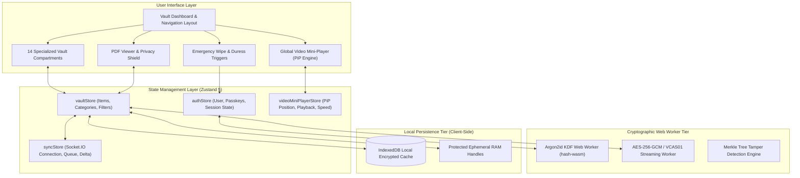
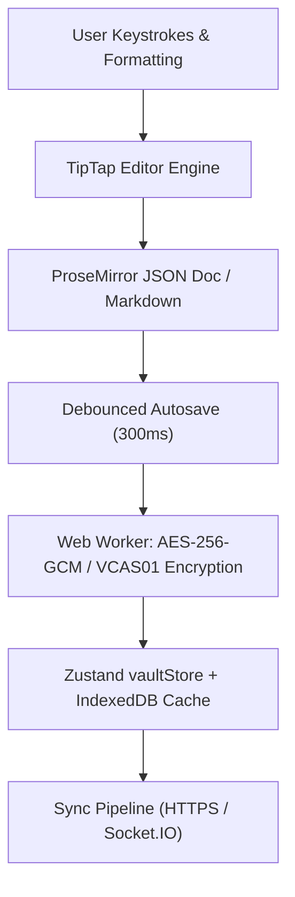
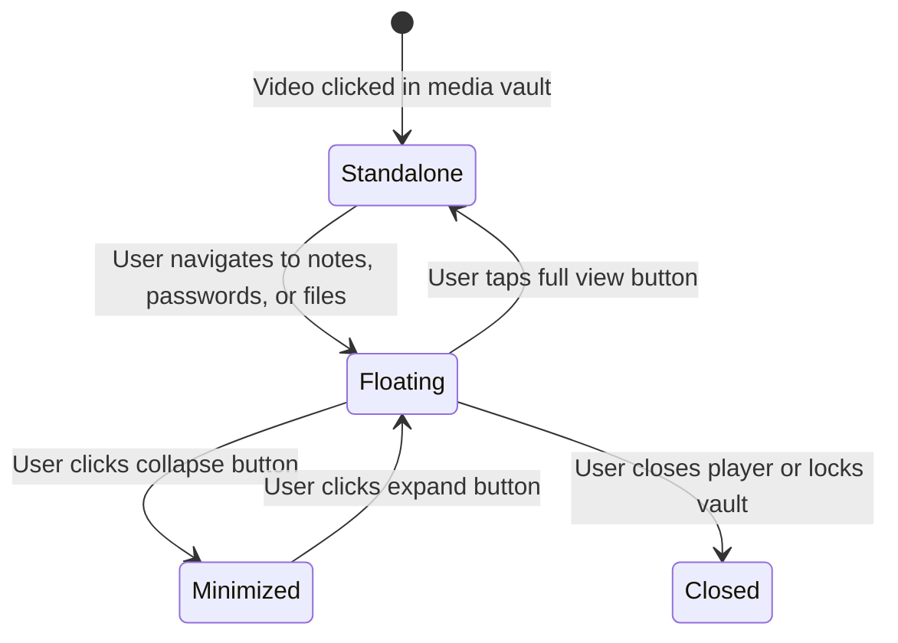
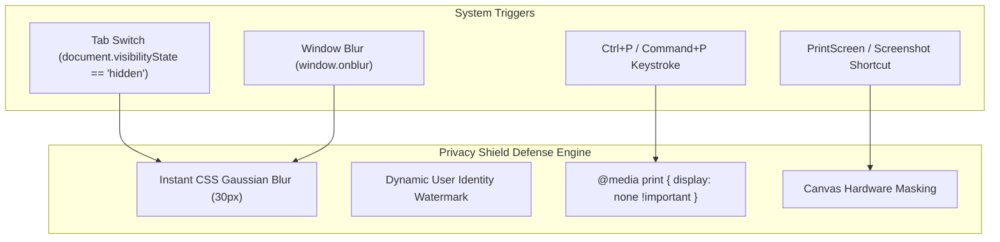
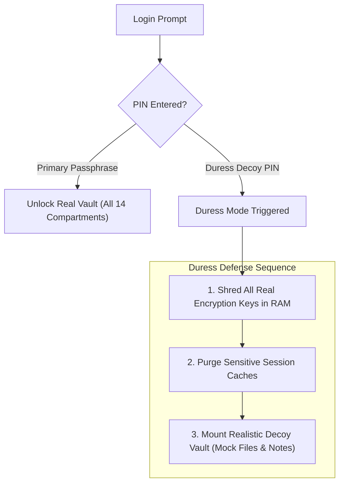
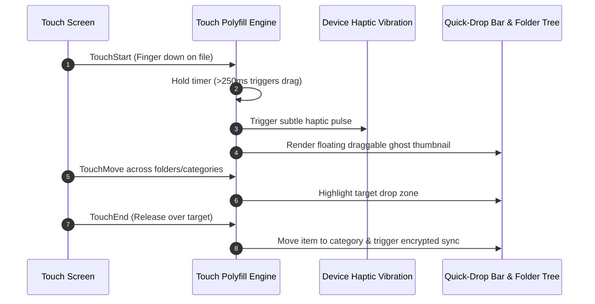

# 💻 Frontend Architecture & Client Features (`doc/client-features.md`)

This document explores the client-side architecture, user experience innovations, state management topology, and privacy safeguards implemented in **Vault**'s React 19 frontend.

---

## 1. Frontend Architecture & Component Topology

Vault's frontend is constructed on **React 19**, **Vite**, **TypeScript 5.8**, and **Tailwind CSS 4**, leveraging a decoupled state machine architecture:

---

## 2. TipTap 3.32 Rich Text Editor & Live Note Encryption

Vault integrates **TipTap 3.32** (built on the ProseMirror document model) in `src/features/vault/NotesVault.tsx` to deliver an encrypted rich text editor with native Markdown support:

### Key Capabilities:

- **Markdown Shortcuts**: Type `# `, `## `, `**bold**`, `> `, `- [ ]`, or `---` to trigger formatting instantly.
- **Rich Extensions**: Inline highlighting, embedded tables with cell splitting and insertion, task lists, code blocks with syntax highlighting, and encrypted image embedding.
- **Client-Side Autosave**: Changes are serialized and encrypted in a dedicated Web Worker on a 300ms debounce loop, ensuring zero UI stutter and immediate persistence to IndexedDB before remote delta sync.

---

## 3. Global Floating Video Mini-Player (Picture-in-Picture)

Vault features a persistent, floating video player (`GlobalVideoMiniPlayer`) that remains active across view transitions, navigation, and folder browsing.

### Architectural Highlights (`videoMiniPlayerStore.ts` & `GlobalVideoMiniPlayer.tsx`):

- **Global State Isolation**: Managed via Zustand (`videoMiniPlayerStore`), preserving playback position, volume, playback speed (0.5x to 2.0x), and visual filter settings across route changes.
- **Picture-in-Picture Modes**: Supports browser-native PiP API alongside an in-DOM floating overlay with drag positioning and edge snapping.
- **Visual Filters**: Real-time canvas filters: Grayscale, Contrast Enhancement, Sepia, Invert, and Night-Vision presets.
- **Encrypted Media Streaming**: Streams chunked media directly from encrypted blob streams via signed HMAC URLs without downloading whole video files first.

---

## 4. Sandboxed PDF & Document Privacy Shield

Viewing sensitive documents (passports, financial statements, contracts) in a web browser introduces vulnerabilities: shoulder surfing, screenshot snooping, and window switching previews.

Vault implements a multi-tier **Privacy Shield** (`PdfViewer.tsx` and `useAntiScreenshotAndShield.ts`):

### Privacy Protections:

- **Tab-Switch Blurring**: The instant a user switches tabs or minimizes the window, the document viewer applies a 30px CSS blur and black masking layer to prevent OS-level preview caching.
- **Anti-Screenshot Deterrence**: Displays an animated watermark displaying authenticated username, timestamp, and device fingerprint.
- **Print Prevention**: Suppresses print shortcuts and injects print media CSS clearing DOM rendering during print dialog invocation.

---

## 5. Audio Vault & Waveform Visualizer (`AudioVault.tsx`)

- **Voice Memo Recording**: Direct in-browser encrypted recording using Web Audio API and MediaRecorder without creating unencrypted temporary files on disk.
- **Real-Time Waveform Visualizer**: Live HTML5 Canvas rendering of frequency bars and audio amplitudes during recording and playback.
- **Playback Controls**: Variable speed playback (0.5x to 2.0x), waveform scrub-to-seek, and looping.

---

## 6. Password Manager & Credential Security (`PasswordManager.tsx`)

- **Entropy & Strength Engine**: Real-time password scoring powered by **zxcvbn**, evaluating dictionary attacks, l33t-speak patterns, and spatial keyboards.
- **Breach Verification (k-Anonymity)**: Checks passwords against billions of breached credentials via HaveIBeenPwned API sending only the first 5 characters of the SHA-1 hash; full passwords never leave the client.
- **Password Generator**: Configurable cryptographic entropy generator (passphrases, length, symbols, numbers, character exclusion).
- **Auto-Clipboard Shredder**: Copied credentials auto-wipe from the system clipboard after 30 seconds.

---

## 7. Secrets & Key Recovery Management (`SecretsVault.tsx`)

- **BIP-39 Mnemonic Seed Generator**: Generates and verifies 12, 18, and 24-word cryptocurrency recovery phrases with standard checksum validation.
- **Key Partitioning**: Dedicated fields for SSH private keys, PGP keys, cloud API tokens, and Post-Quantum Kyber-768 key pairs.
- **One-Click Visibility Masking**: Sensitive fields are hidden behind masked asterisks by default with 5-second reveal timers.

---

## 8. Cards & Payment Methods Vault (`CardsVault.tsx`)

- **Luhn Algorithm Verification**: Automatic client-side checksum validation of credit/debit card numbers before saving.
- **Dynamic Card Brand Rendering**: Automatic card issuer detection (Visa, MasterCard, American Express, Discover, JCB) with tailored visual card themes.
- **CVV Privacy Shield**: CVV security codes remain obscured with optional toggle.

---

## 9. Contacts, Identities & Wi-Fi Vaults

- **Contacts Vault (`ContactsVault.tsx`)**: Encrypted personal contacts directory with search, relationship categorization, and standard vCard (`.vcf`) export.
- **Identities Vault (`IdentitiesVault.tsx`)**: Secure storage for passport numbers, national IDs, driver licenses, and tax IDs, with encrypted multi-page document attachment support.
- **Wi-Fi Vault (`WifiVault.tsx`)**: Network credentials (SSID, WPA2/WPA3 keys) with instant dynamic QR code generation for camera-based quick joining.

---

## 10. Location, Todo, Chat & Other Files Vaults

- **Location Vault (`LocationVault.tsx`)**: Encrypted geographic coordinates, physical addresses, altitude, and one-click navigation links to OpenStreetMap and Google Maps.
- **Todo & Tasks Vault (`TodoVault.tsx`)**: Encrypted task manager with priority tags (Urgent, High, Medium, Low), checklists, and completion timestamps. Fully verified by automated security test suites.
- **Chat Vault (`ChatVault.tsx`)**: Private encrypted messaging threads with configurable self-destruct timers (1 hour, 24 hours, 7 days).
- **Other Files Vault (`OtherFilesVault.tsx`)**: Arbitrary binary and document storage supporting files up to 500MB with drag-and-drop chunked uploads and SHA-256 verification.

---

## 11. Physical Coercion Defense & Decoy Vault Partition

### Plausible Deniability Under Hostile Inspection:

- If a user is physically compelled to unlock their vault, entering the pre-configured **Duress PIN** instantly shreds real master keys in RAM and loads a realistic decoy partition populated with benign documents, receipts, and photos.
- The UI gives zero indication that decoy mode has been triggered.

---

## 12. Cross-Device Touch Drag-and-Drop Polyfill

Mobile browsers often struggle with HTML5 drag-and-drop. Vault incorporates a touch-optimized drag-and-drop system:

This ensures desktop-class drag-and-drop fluidity on touch devices, iPads, and Android smartphones.
