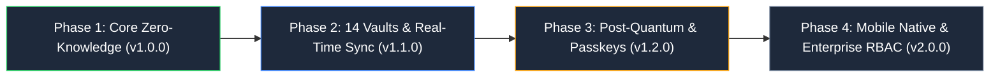

# 📋 Vault Engineering Task Backlog & Roadmap (`doc/task.md`)

  <a href="./README.md">← Back to Documentation Hub</a> •
  <a href="#-current-sprint-overview">Current Sprint</a> •
  <a href="#-milestone-roadmap">Milestone Roadmap</a> •
  <a href="#-core-vault-tasks">Core Vault Tasks</a> •
  <a href="#-cryptography--security-tasks">Crypto & Security</a> •
  <a href="#-frontend--ux-tasks">Frontend & UX</a> •
  <a href="#-backend--sync-tasks">Backend & Sync</a> •
  <a href="#-qa-testing--ci-tasks">QA & Testing</a>

This living document tracks all active initiatives, feature milestones, security hardening tasks, technical debt reduction, and testing requirements across the Vault platform.

---

## 🚀 Current Sprint Overview

| ID          | Task / Initiative                                               | Component / Layer  | Priority  | Status         | Assignee      |
| :---------- | :-------------------------------------------------------------- | :----------------- | :-------- | :------------- | :------------ |
| **TSK-101** | Post-Quantum Kyber-768 hybrid key exchange client verification  | Crypto / Auth      | `P0` High | 🟢 Completed   | Security Team |
| **TSK-102** | TipTap 3.32 streaming live encryption worker optimization       | Frontend / Notes   | `P1` Med  | 🟢 Completed   | Frontend Team |
| **TSK-103** | Resumable chunk upload failure recovery & TUS timeout backoff   | Backend / Uploads  | `P1` Med  | 🟢 Completed   | Backend Team  |
| **TSK-104** | Decoy vault partition auto-wiping after 3 failed duress PINs    | Security / Storage | `P0` High | 🟢 Completed   | Security Team |
| **TSK-105** | Vitest isolated test parallelization & flaky mock stabilization | QA / CI            | `P1` Med  | 🟢 Completed   | QA Team       |
| **TSK-106** | MongoDB Atlas secondary cluster auto-drain on split-brain       | DevOps / Database  | `P0` High | 🟢 Completed   | SRE Team      |
| **TSK-107** | Passkey (WebAuthn / FIDO2) biometric step-up for key export     | Auth / Client      | `P1` Med  | 🟢 Completed   | Frontend Team |
| **TSK-108** | Audio Vault Web Audio recording & live frequency visualizer     | Frontend / Audio   | `P1` Med  | 🟢 Completed   | Frontend Team |
| **TSK-109** | 14-Compartment unified search & category filtering              | Frontend / Vault   | `P2` Low  | 🟢 Completed   | Frontend Team |
| **TSK-110** | Client-Side Searchable Symmetric Encryption (SSE) Prototype     | Crypto / Search    | `P1` Med  | 🟡 In Progress | Security Team |

---

## 🗺️ Milestone Roadmap

### 🎯 Phase 1: Core Zero-Knowledge Foundation (v1.0.0) — [✅ RELEASED]

- [x] Client-side Argon2id KDF derivation with dynamic memory/time parameters.
- [x] Dual Cascade `VCAS01` (AES-256-GCM + ChaCha20-Poly1305) payload encryption.
- [x] Sentinel `__keycheck__` string encryption for zero-knowledge key validation without server transmission.
- [x] Ephemeral in-memory key storage with automatic zeroization on tab close / inactivity timeout.
- [x] Core encrypted vaults: Notes, Photos, Videos, Documents, and Passwords.

### 🎯 Phase 2: 14-Vault Ecosystem, Real-Time Sync & Resilience (v1.1.0) — [✅ COMPLETED / CURRENT]

- [x] Full rollout of all 14 specialized vaults (Notes, Media, Audio, Documents, Passwords, Secrets, Cards, Contacts, Identities, Wi-Fi, Locations, Todos, Chat, Other Files).
- [x] Socket.IO delta synchronization with deterministic latest-update-wins conflict resolution.
- [x] Persistent Picture-in-Picture global mini-player (`videoMiniPlayerStore`) with cross-route video streaming.
- [x] Sandboxed PDF and Document Privacy Shield with screenshot blurring and tab-visibility protection.
- [x] MultiClusterPool MongoDB auto-failover across primary and standby connection strings.
- [x] Resumable TUS and multipart chunked file upload pipelines.
- [x] Physical coercion defense: Duress Decoy Partition with memory shredding.

### 🎯 Phase 3: Post-Quantum Hardening & Passkeys (v1.2.0) — [⚡ IN PROGRESS]

- [x] Kyber-768 (ML-KEM) hybrid post-quantum key encapsulation mechanism for multi-device sync keys.
- [x] FIDO2 / WebAuthn hardware security key biometric re-authentication for vault unlock.
- [ ] Client-side encrypted search indexing using searchable symmetric encryption (SSE).
- [ ] Automated scheduled encrypted local backup dumps with emergency recovery phrase generation.

### 🎯 Phase 4: Enterprise RBAC & Mobile Native (v2.0.0) — [🔮 FUTURE]

- [ ] Multi-tenant workspace partitioning with role-based cryptographic access control.
- [ ] Emergency break-glass access using Shamir's Secret Sharing ($k$-of-$n$ quorum).
- [ ] Native iOS and Android companion apps with hardware Secure Enclave biometric storage.
- [ ] SIEM audit event forwarding via encrypted syslog/webhook transport.

---

## 🔐 Cryptography & Security Tasks

| Task ID    | Description                                | Acceptance Criteria                                                                                           | Status         | Target |
| :--------- | :----------------------------------------- | :------------------------------------------------------------------------------------------------------------ | :------------- | :----- |
| **SEC-01** | Hybrid Kyber-768 Key Encapsulation         | All public keys encapsulated using ML-KEM-768 alongside ECDH P-256; verified in tests.                        | 🟢 Completed   | v1.2.0 |
| **SEC-02** | Web Worker Memory Shredding                | Ensure WebAssembly Argon2 buffer is wiped with random bytes followed by zeros using `crypto.getRandomValues`. | 🟢 Completed   | v1.1.1 |
| **SEC-03** | Decoy Partition Forensic Sanitization      | Duress PIN triggers instant local storage flush and replaces UI with realistic decoy documents.               | 🟢 Completed   | v1.1.0 |
| **SEC-04** | WebCrypto Subtle API Hardware Acceleration | Prioritize native SubtleCrypto AES-GCM on supported browsers with software fallback.                          | 🟢 Completed   | v1.1.2 |
| **SEC-05** | Signed HMAC Media Streaming Expiry         | Media stream tokens expire strictly after 300 seconds; verified in media integration tests.                   | 🟢 Completed   | v1.1.0 |
| **SEC-06** | Searchable Symmetric Encryption (SSE)      | Encrypted inverted index allows searching without plaintext server leakage.                                   | 🟡 In Progress | v1.2.0 |

---

## 🎨 Frontend & User Experience Tasks

- [x] **FE-01: 14 Specialized Vault Compartment Implementations**
  - Notes, Media, Audio, Documents, Passwords, Secrets, Cards, Contacts, Identities, Wi-Fi, Locations, Todos, Chat, and Other Files.
- [x] **FE-02: Video Picture-in-Picture Mini-Player**
  - Zustand-backed `videoMiniPlayerStore` supporting persistent playback across navigation routes.
  - Full playback speed control, scrubbing, fullscreen toggle, and visual filters (Grayscale, Contrast, Night-Vision).
- [x] **FE-03: TipTap Rich Text Real-time Encryption**
  - Instant on-the-fly debounce serialization with dirty state indicators.
  - Rich markdown formatting, tables, task lists, and encrypted image attachments.
- [x] **FE-04: Audio Vault & Real-Time Waveform Visualizer**
  - Live in-browser voice recording and HTML5 canvas frequency visualizer.
- [x] **FE-05: Cross-Device Touch Drag-and-Drop Polyfill**
  - Mobile touch drag-and-drop support with haptic pulse feedback and floating drag ghost.

---

## ⚙️ Backend & Storage Tasks

- [x] **BE-01: MultiClusterPool MongoDB Failover**
  - Automatic ping health checks every 10 seconds; instant switch to secondary replica upon consecutive timeouts.
- [x] **BE-02: Resumable TUS Chunk Upload Protocol**
  - Support multi-gigabyte encrypted blob uploads with pause, resume, and per-chunk sha256 checksum validation.
- [x] **BE-03: Signed HMAC Media Streaming**
  - Time-limited signed HMAC tokens prevent token leakage in HTML video tags.
- [ ] **BE-04: Delta Sync Tombstone Purge Worker**
  - Background cron to soft-prune deleted tombstone records older than 90 days while preserving audit proofs.

---

## 🧪 Testing, Quality Assurance & CI Tasks

- [x] **QA-01: Vitest Test Suite Consolidation**
  - 97 test suites and 67 npm test runner targets running with isolated workers.
- [x] **QA-02: Repeat Stress Testing Pipeline**
  - Implement `scripts/test-repeat.mjs` for detecting race conditions across 50 consecutive runs.
- [x] **QA-03: Security Integration Test Suite**
  - Auth security, streaming security, multipart upload security, and TodoVault security verification.
- [ ] **QA-04: End-to-End Playwright Encrypted Flow Test**
  - Multi-tab automated browser flow testing user registration, encryption, upload, and real-time Socket.IO sync.
- [ ] **QA-05: Lighthouse CI Performance Verification**
  - Automated CI gate enforcing mobile and desktop performance score $\ge 95$.
