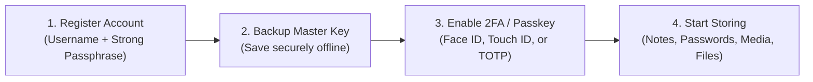
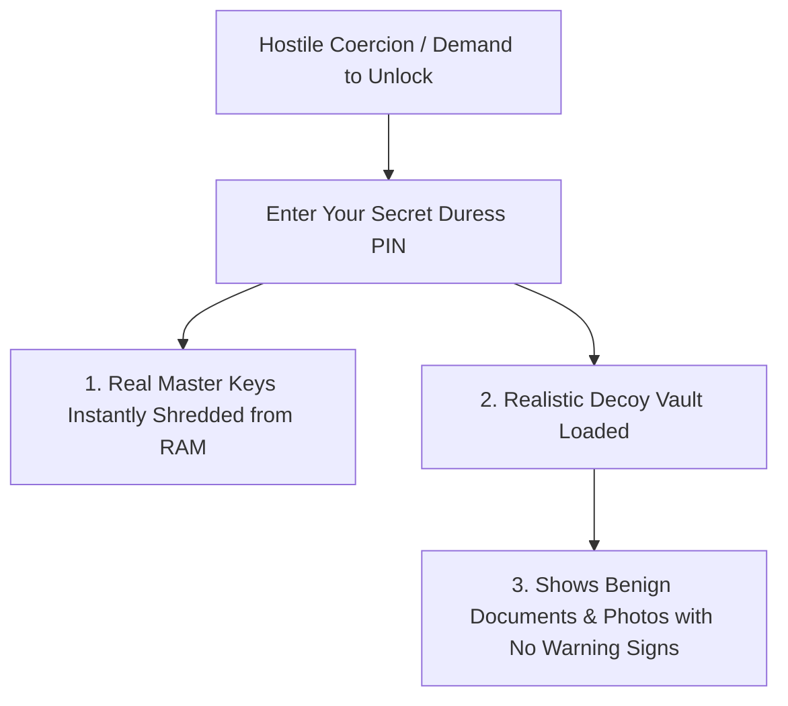

# 📖 User-Friendly Handbook & Everyday Guide (`doc/user-guide.md`)

Welcome to **Vault**! This guide is written in clear, simple terms to help you master your encrypted personal locker, protect your privacy, and use all of Vault's features effortlessly across desktop and mobile devices.

---

## 1. What is Vault? (In Plain English)

Traditional cloud storage platforms (Google Drive, Dropbox, iCloud) store your files and passwords in a format they can decrypt. If their servers are breached, rogue employees go snooping, or governments demand access, your private data can be read.

**Vault is completely different**:

- **Zero-Knowledge Privacy**: Your photos, videos, confidential notes, passwords, and PDF documents are encrypted on your device **before** they are sent to the cloud.
- **You Hold the Only Key**: Only your master passphrase can unlock your data. Even the system administrator, database hosting providers, or cloud servers see only scrambled random characters.
- **Real-Time Cross-Device Sync**: Any change you make on your phone or laptop instantly syncs across all your connected devices in real time.

---

## 2. Getting Started: Account Setup & First Steps



### 2.1 The Golden Rule of Zero-Knowledge: Protect Your Passphrase!

> [!CAUTION]
> **There is NO "Forgot Password" Link!**
> Because Vault is 100% Zero-Knowledge, the server **never** stores your master passphrase. If you lose your passphrase, no one on Earth can decrypt your data. Store your passphrase in a physically secure place or safe notebook!

### 2.2 Adding Extra Protection: Passkeys & Two-Factor Authentication (2FA)

1. Go to **Settings** $\rightarrow$ **Security & 2FA**.
2. **Biometric Passkeys (Recommended)**: Click **Add Passkey** to sign in using **Face ID**, **Touch ID**, or **Windows Hello** — fast, seamless, and completely immune to phishing attacks.
3. **Authenticator App (TOTP)**: Click **Enable 2FA**, scan the QR code using Google Authenticator, Authy, or 1Password, and save the backup recovery codes.

---

## 3. Daily Usage: Exploring the 14 Specialized Vaults

Vault organizes your digital life into 14 purpose-built encrypted compartments:

```
+-----------------------------------------------------------------------------------------+
|                                🏛️ VAULT ECOSYSTEM MODULES                               |
+-----------------------------------------------------------------------------------------+
|  1. 📝 Notes Vault       - Rich text formatting, checklists, Markdown & autosaving      |
|  2. 📷 Media Vault       - Encrypted photo/video gallery, EXIF stripping, PiP player    |
|  3. 🎵 Audio Vault       - Encrypted voice memos, visual waveform analyzer, audio player|
|  4. 📄 Documents Vault   - PDF viewer with tab-switch blurring & anti-screenshot mask   |
|  5. 🔑 Password Manager  - Secure credentials, password generator & breach checks       |
|  6. 🗝️ Secrets Vault     - BIP-39 mnemonic recovery seeds, private API & crypto keys    |
|  7. 💳 Cards Vault       - Credit & debit cards, Luhn checksum validation, CVV masking  |
|  8. 👤 Contacts Vault    - Encrypted address book, avatars, notes, vCard export         |
|  9. 🆔 Identities Vault  - Passports, national IDs, driver licenses, scan attachments  |
| 10. 📶 Wi-Fi Vault       - Network SSIDs, passwords, encryption modes, QR generators    |
| 11. 📍 Location Vault    - Coordinates, addresses, interactive map pins, travel notes   |
| 12. ✅ Todo Vault        - Checklists, priorities, deadline alerts, encrypted subtasks  |
| 13. 💬 Chat Vault        - Private encrypted messages, self-destruct timers, media clips|
| 14. 📁 Other Files Vault - Arbitrary binary storage, bulk upload, MIME validation       |
+-----------------------------------------------------------------------------------------+
```

---

### 📝 3.1 Notes Vault: Rich Text & Markdown Editing

Write daily journals, confidential thoughts, meeting notes, or project tasks using the built-in **TipTap** editor:

- **Instant Markdown Shortcuts**: Type `# ` for large heading, `## ` for subheading, `- [ ] ` for to-do items, `> ` for blockquotes, and `***` for dividers.
- **Automatic Saving**: Notes autosave 300ms after you stop typing. No need to click "Save"!
- **Local Decryption**: Your notes decrypt instantly on your device so browsing feels instantaneous.

---

### 📷 3.2 Photos & Media Vault

Safely archive private family photos, identification scans, and personal memories:

- **Automatic EXIF Stripping**: Vault automatically strips sensitive GPS location data, camera serial numbers, and device models from photos before encryption.
- **In-Browser Decryption**: High-resolution photos are decrypted directly in your browser's memory without leaving unencrypted temporary files on your hard drive.
- **Live Camera Capture**: Tap the Camera icon to capture encrypted photos or audio memos directly into your vault without leaving traces in your phone's camera roll.

---

### 🎬 3.3 Persistent Floating Video Mini-Player (Picture-in-Picture)

Watch encrypted private videos while taking notes or organizing files:

- **Picture-in-Picture**: Click the PiP icon on any video to pop it out into a floating window that stays on top as you switch tabs or vaults.
- **Visual Filters**: Switch between Normal, Contrast Boost, Night-Vision, Inverted, and Grayscale filters directly inside the player.
- **Playback Controls**: Adjust playback speed from 0.5x to 2.0x, scrub forward/back 10 seconds, and adjust volume.

---

### 🎵 3.4 Audio Vault: Voice Notes & Waveform Visualizer

Record private voice memos or store confidential audio recordings:

- **Encrypted Voice Recording**: Click the microphone icon to record encrypted voice memos directly in your browser.
- **Live Frequency Waveform**: View the audio wave visualizer in real time during playback.
- **Variable Playback**: Speed up audio playback up to 2.0x for rapid listening.

---

### 📄 3.5 Document Shield & PDF Privacy Viewer

Read sensitive PDFs, tax returns, and confidential contracts with zero risk of shoulder snooping:

- **Anti-Screenshot Blurring**: As soon as you switch tabs or minimize the window, the document instantly blurs with a 30px Gaussian mask.
- **Dynamic Watermark**: A floating watermark with your username and timestamp discourages unauthorized photography.
- **Print Protection**: Attempts to print the page (`Ctrl+P` / `Cmd+P`) are blocked and blank out the content.

---

### 🔑 3.6 Password Manager & Breach Checker

Store all your logins securely:

- **Instant Password Generator**: Generate ultra-strong passwords with customized symbols, numbers, and length.
- **Breach Alert**: Vault checks your passwords against known data breaches without ever revealing your actual password (using k-anonymity).
- **Auto-Clipboard Clear**: Copied passwords automatically wipe from your clipboard after 30 seconds.

---

### 🗝️ 3.7 Secrets Vault: Crypto Recovery Seeds & API Keys

Designed for cryptocurrency users, developers, and security professionals:

- **BIP-39 Seed Phrase Generator**: Generate and verify 12, 18, or 24-word recovery seeds with checksum validation.
- **API & SSH Keys**: Dedicated encrypted fields for private server keys, cloud tokens, and post-quantum keys.
- **Quick Masking**: All secrets are hidden behind dots with a 5-second reveal timer.

---

### 💳 3.8 Payment Cards Vault

Store credit cards, debit cards, and banking information:

- **Card Detection**: Automatically detects Visa, Mastercard, Amex, and Discover with realistic card previews.
- **Luhn Checksum Check**: Validates card numbers client-side to prevent typos before saving.
- **CVV Privacy Shield**: CVV security codes remain hidden until toggled.

---

### 👤 3.9 Contacts Vault

Keep your sensitive personal and business contacts encrypted:

- Encrypt names, phone numbers, email addresses, and private notes.
- Import and export contacts via standard vCard (`.vcf`) format.

---

### 🆔 3.10 Identities Vault

Store passports, national ID cards, driver licenses, and tax cards:

- Store document numbers, expiration dates, and issuing countries.
- Attach high-resolution encrypted scans of front and back cards.

---

### 📶 3.11 Wi-Fi Vault

Organize all your home, office, and travel Wi-Fi credentials:

- Store SSID names, security protocols (WPA3, WPA2, WEP), and passphrases.
- **One-Click QR Code**: Generate a dynamic QR code that friends or your mobile camera can scan to connect instantly without typing passwords.

---

### 📍 3.12 Location Vault

Bookmark sensitive travel locations, emergency meeting points, and coordinates:

- Store latitude/longitude coordinates and street addresses.
- Launch directly into OpenStreetMap or Google Maps with one click.

---

### ✅ 3.13 Todo & Tasks Vault

Organize confidential tasks, checklists, and project deadlines:

- Categorize by priority: Urgent, High, Medium, Low.
- Set due dates and interactive checkboxes that sync across all your devices.

---

### 💬 3.14 Chat Vault: Ephemeral Encrypted Messages

Communicate securely with temporary encrypted notes or messaging threads:

- Set auto-delete timers (1 hour, 24 hours, 7 days).
- Messages are erased from memory and disk upon expiration.

---

### 📁 3.15 Other Files Vault

Store arbitrary encrypted files, archives (ZIP), and binaries up to 500MB:

- Drag and drop files from desktop or mobile file manager.
- Client-side SHA-256 verification guarantees file integrity.

---

## 4. Physical Coercion Defense: Duress Decoy Vault

If you are ever forced by an attacker, border inspector, or hostile actor to unlock your device under physical threat:



1. **Setup**: Go to **Settings** $\rightarrow$ **Duress PIN** and set a secondary PIN.
2. **Execution**: At the login screen, enter your **Duress PIN** instead of your master passphrase.
3. **What Happens**:
   - Vault **instantly wipes all primary keys from device RAM**.
   - Vault renders a pre-configured decoy vault with authentic-looking notes, receipts, and photos.
   - The inspecting party sees a functional vault with zero clue that duress mode was triggered.

---

## 5. Keyboard Shortcuts & Power User Tips

| Shortcut               | Action                                            |
| :--------------------- | :------------------------------------------------ |
| `Ctrl + L` / `Cmd + L` | **Instant Vault Lock** (Zeroizes all keys in RAM) |
| `Ctrl + K` / `Cmd + K` | **Global Search** across all 14 compartments      |
| `Ctrl + N` / `Cmd + N` | **New Note / Item** in the active compartment     |
| `Ctrl + Shift + D`     | **Trigger Emergency Decoy View**                  |
| `Escape`               | Close any open modal or viewer                    |

---

## 6. Frequently Asked Questions (FAQ)

### Can the Vault team reset my password if I lose it?

**No.** Vault is mathematically zero-knowledge. Your keys never leave your browser. If you lose your passphrase and recovery kit, your data cannot be recovered.

### How does multi-device sync work?

Vault uses secure WebSockets (`Socket.IO`). When you save an item on your laptop, the encrypted ciphertext is pushed to the server, which notifies your phone to download the new encrypted blob and decrypt it locally in milliseconds.

### Are my files safe if the Vault server is hacked?

**Yes.** All data stored on the server is fully encrypted with AES-256-GCM / VCAS01 dual cascade ciphers. An attacker who steals the entire database will obtain only scrambled ciphertext.
