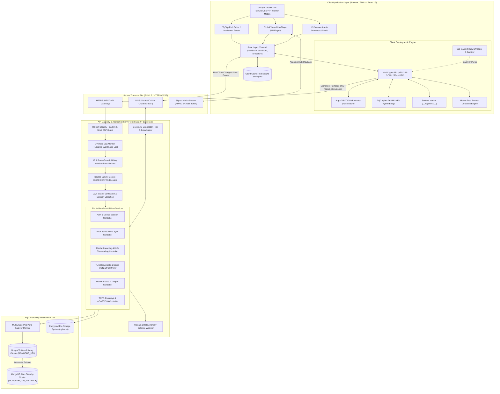
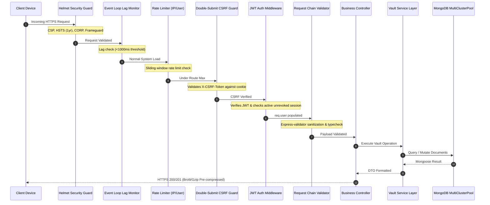
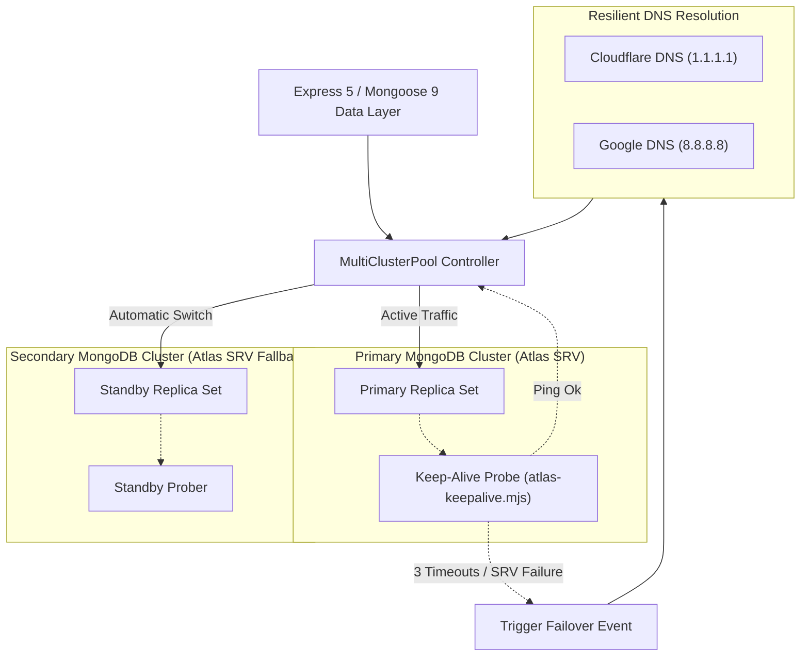

# 🏛️ Architecture & System Design Blueprint (`doc/design.md`) — Vault

---

## 1. Executive Summary, Mission & Core Guarantees

**Vault** is an enterprise-grade, zero-knowledge personal data vault and real-time cloud synchronization platform. Engineered to protect confidential user documents, biometric tokens, encrypted notes, media streaming archives, credentials, and cryptographic keys, Vault enforces strict client-side encryption before any byte leaves device memory.

### Core Architectural Guarantees:

1. **Zero-Knowledge Data Boundary**: All sensitive assets are encrypted on the client device using authenticated symmetric ciphers (**AES-256-GCM** or **`VCAS01` Dual-Cipher Cascade**). The backend application, database administrators, and network intermediaries never possess plaintext data or cryptographic keys.
2. **Dual-Key Isolation**: The account authentication credential (`AuthKey`, hashed via server-side bcrypt with salt and server pepper) is cryptographically isolated from the client-side master encryption key (`MasterKey`, derived via memory-hard **Argon2id**).
3. **Post-Quantum Cryptographic Forward Secrecy**: Integration of lattice-based **PQC Kyber-768 (ML-KEM, NIST FIPS 203)** combined with classical **X25519 ECDH** protects stored archives against *Harvest Now, Decrypt Later (HNDL)* quantum decryption adversaries.
4. **Real-Time Cross-Device Synchronization**: Sub-50ms event propagation powered by **Socket.IO** rooms with deterministic timestamp arbitration (`latest-update-wins`) and soft-delete tombstone tracking.
5. **High Availability Multi-Cluster Failover**: Seamless automatic database cluster failover between MongoDB Atlas primary and secondary clusters via `MultiClusterPool` with DNS resolution retries and zero server restarts.
6. **Ephemeral RAM Security**: Inactivity key shredder zeroizes all cryptographic buffers and in-memory key handles after 60 seconds of user idle time.

---

## 2. High-Level System Architecture

The following diagram illustrates the end-to-end component topology, data flows, and zero-trust trust boundaries:



---

## 3. Cryptographic Separation & Trust Boundaries

The system is separated into three distinct security enclaves:

```
+-----------------------------------------------------------------------------------+
| ENCLAVE 1: CLIENT EPHEMERAL SECURE ENCLAVE (Web Browser)                         |
| - Plaintext user notes, passwords, photos, TOTP secrets                          |
| - Master Encryption Key (DEK) derived in Web Worker                               |
| - Non-extractable WebCrypto CryptoKey handles                                     |
| - Inactivity watchdog zeroes all buffers on 60-second idle                        |
+-----------------------------------------------------------------------------------+
                                       |
                         TLS 1.3 Ciphertext Pipeline
                                       |
+-----------------------------------------------------------------------------------+
| ENCLAVE 2: API GATEWAY & ROUTING ENCLAVE (Express 5 Server)                       |
| - Blind ciphertext envelopes (IV + Ciphertext + AuthTag)                          |
| - JWT Access Tokens (12-hour lifespan) & Rotating Refresh Cookies                 |
| - Route rate limiters, reCAPTCHA v2/v3 verification, and IP anomaly tracking     |
| - Zero access to decryption keys or plaintext content                             |
+-----------------------------------------------------------------------------------+
                                       |
                           Mongoose 9 / TLS Direct SRV
                                       |
+-----------------------------------------------------------------------------------+
| ENCLAVE 3: MULTI-CLUSTER STORAGE ENCLAVE (MongoDB Atlas + Disk)                   |
| - User document collection with encrypted field sub-documents                     |
| - Encrypted control records: __keycheck__, __settings__, __logs__, __profile__    |
| - Soft-deleted tombstones (isDeleted: true, deletedAt: ISO)                       |
| - Sliced chunk files and AES-encrypted binary video assets                        |
+-----------------------------------------------------------------------------------+
```

---

## 4. Frontend Subsystem Deep Dive (React 19 + TypeScript)

### 4.1 State Management & Architecture (`src/store/`)
Vault utilizes **Zustand** stores decoupled from UI components, backed by **IndexedDB** (`idb` library) for instantaneous local load times:

- **`vaultStore.ts`**: Central catalog of decrypted notes, passwords, files, and bookmarks. Handles background synchronization, item tagging, folder nesting, and search filtering.
- **`authStore.ts`**: Manages login state, current user profiles, device identifiers, and active token lifecycles.
- **`syncStore.ts`**: Tracks pending outbound mutations, conflict queues, connection quality, and synchronization cursors.
- **`videoMiniPlayerStore.ts`**: Drives the Picture-in-Picture floating mini-player, managing video element detachment, scrub timestamps, volume, visual filter presets, and player sizing across page navigation.
- **`integrityStore.ts`**: Maintains the local Merkle tree state, leaf hash collections, and audit logs.

### 4.2 Web Worker Cryptographic Offloading
To ensure zero frame drops (60 FPS / 120 FPS UI smoothness) during heavy key derivation:
- Argon2id key derivation runs inside a dedicated Web Worker via `hash-wasm`.
- Master passphrases pass via `postMessage` transfer buffers, derived into 32-byte raw keys, converted to non-extractable `CryptoKey` instances in WebCrypto, and the transfer buffer is explicitly wiped.

### 4.3 Floating Video Mini-Player (PiP)
- **Persistent Overlay**: Implemented in `GlobalVideoMiniPlayer.tsx`, allowing users to watch encrypted video tutorials, private recordings, or camera streams while taking notes in the TipTap editor or managing passwords.
- **Picture-in-Picture Support**: Toggles between browser-native PiP API (if supported) and an in-DOM draggable, corner-snapping overlay equipped with collapse, minimize, timeline scrub, playback speed, and video filter controls.

### 4.4 Mobile PDF & Privacy Shield
- **Sandboxed Rendering**: PDF files render via in-browser canvas without executing embedded document JavaScript.
- **Tab-Switch Blurring**: `useAntiScreenshotAndShield.ts` monitors document visibility. When `document.visibilityState === 'hidden'` or `window.onblur` fires, a 30px Gaussian blur and opaque blackout shield instantly covers the viewport, preventing operating system window-switching previews from recording document contents.
- **Print & Capture Suppression**: Injects dynamic `@media print { display: none !important; }` rules and renders dynamic identity watermarks (username, client IP, timestamp).

### 4.5 Touch Drag-and-Drop Engine
- Designed specifically for touch devices (iOS Safari, Android Chrome) where standard HTML5 drag-and-drop fails.
- Features a **200ms hold initiation timer** to differentiate between page scrolling and item pickup.
- Triggers **haptic vibration pulses** upon item pickup, folder target hover, and drop confirmation.
- Safe-area compliance (`env(safe-area-inset-bottom)`) dynamically elevates the drop targets above mobile navigation bars.

---

## 5. Backend Gateway & Micro-Engine Architecture (Express 5)

### 5.1 Request Processing Pipeline



### 5.2 Server Overload Protection & Lag Shield
Under heavy denial-of-service attempts or high CPU loads:
- Node.js `perf_hooks` monitor (`monitorEventLoopDelay`) tracks event-loop latency.
- If event-loop lag exceeds `EVENT_LOOP_LAG_THRESHOLD_MS` (default: 1000ms), the server sheds load immediately with HTTP `503 Service Unavailable` and a `Retry-After: 5` header, preventing process memory crashes.

### 5.3 Anomaly Detection System
- Tracks failed authentication bursts, invalid MIME uploads, rapid large-file uploads (>100MB within 10 minutes), and hash mismatches.
- High anomaly counts automatically blacklist abusive IP segments and trigger rate limit lockouts.

---

## 6. Multi-Cluster Database Failover Engine (`multiClusterPool.ts`)

Vault guarantees zero-downtime database availability through multi-cluster redundancy:



### Key Failover Features:
- **SRV Resolution Retries**: If default DNS lookups fail, the engine retries using fallback DNS servers (`1.1.1.1, 8.8.8.8`).
- **Direct Connection Support**: Supports `MONGODB_URI_DIRECT` for environments blocking SRV DNS queries.
- **Numbered Secondary URIs**: Supports arbitrary cascading clusters (`MONGODB_URI_1`, `MONGODB_URI_2`, etc.).

---

## 7. Media Streaming & Adaptive Transcoding Architecture

Large video and audio files in Vault are streamed without requiring complete file downloads:

1. **HMAC Signed URLs**:
   - Client requests a signed URL: `POST /api/vault/media/signed-url` with `fileId` and expiration.
   - Server returns a short-lived HMAC-signed token.
   - The media player embeds this signed link, allowing secure direct streaming without passing long-lived authorization bearer tokens in HTML5 media tags.
2. **Adaptive HLS Transcoding**:
   - Videos can be segmented into adaptive **HLS (`.m3u8` playlists and `.ts` chunk files)**.
   - Transcoding service (`transcodingService.ts`) segments encrypted files into standard HLS chunks.
   - The client media player (powered by **HLS.js** and **Shaka Player**) streams and decrypts segments smoothly across varying network conditions.

---

## 8. Asset Optimization & Static Delivery Pipeline

Vault optimizes delivery performance to achieve sub-second load times worldwide:

- **Build-Time Pre-compression**:
  - `vite.config.ts` pre-compresses static JavaScript and CSS assets into both Brotli (`.br`) and Gzip (`.gz`) formats during `npm run build`.
  - Express static server (`server/vite.ts`) inspects `Accept-Encoding` request headers. If `br` is supported, it streams `bundle.js.br` directly from disk with `Content-Encoding: br`.
  - **Zero Runtime CPU Overhead**: The server never compresses static chunks on-the-fly.
- **Module Preloading Polyfills**:
  - `index.html` injects `<link rel="modulepreload">` tags for core runtime chunks, allowing modern browsers to parse dependencies concurrently.
- **Aggressive Caching**:
  - Hashed bundles: `Cache-Control: public, max-age=31536000, immutable`.
  - HTML & Service Worker: `Cache-Control: no-cache, no-store, must-revalidate`.
