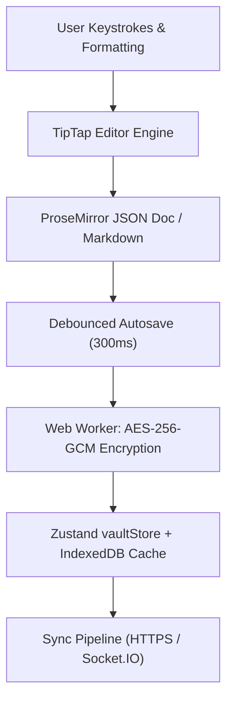
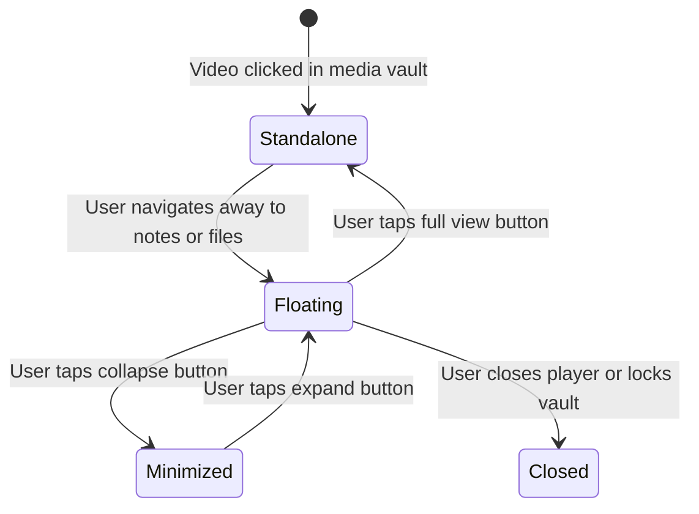
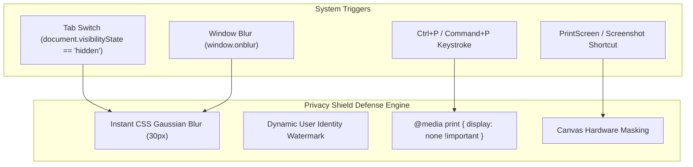
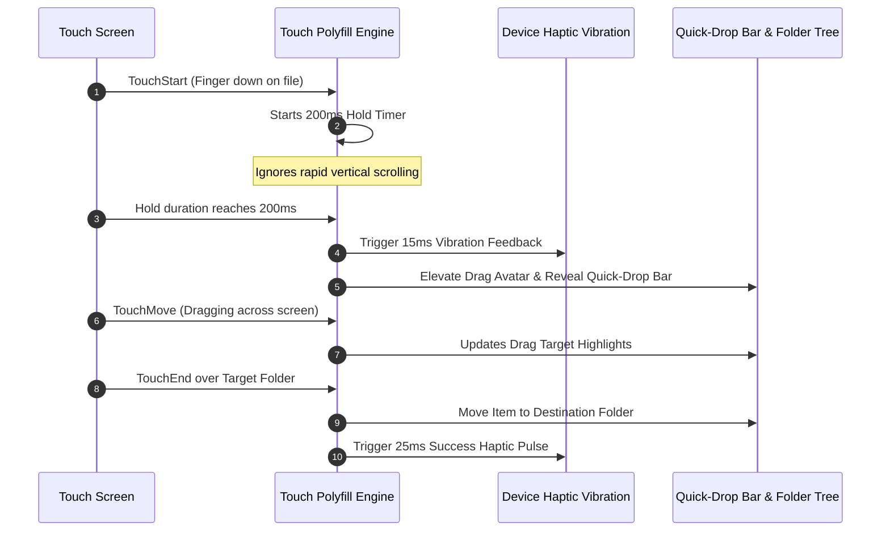

# 💻 Frontend Architecture & Client Features (`doc/client-features.md`)

This document explores the client-side feature modules, user experience innovations, and privacy safeguards implemented in **Vault**'s React 19 frontend.

---

## 1. TipTap Rich Text Editor & Live Note Encryption

Vault integrates **TipTap 3.32** (built on ProseMirror) to provide an encrypted note-taking experience with native Markdown support:

### Key Capabilities:
- **Markdown Shortcuts**: Type `# `, `**bold**`, `> `, `- [ ]` to trigger formatting instantly.
- **Rich Extensions**: Highlight, inline images, tables with cell manipulation, text alignments, task lists, and code blocks.
- **Client-Side Autosave**: Changes are encrypted in a dedicated Web Worker to prevent UI stutter, saving immediately to IndexedDB with background cloud sync.

---

## 2. Floating Video Mini-Player (Picture-in-Picture)

Vault features a persistent, floating video player (`GlobalVideoMiniPlayer`) that remains active across view transitions, navigation, and folder browsing.

### Architectural Highlights (`videoMiniPlayerStore.ts` & `GlobalVideoMiniPlayer.tsx`):
- **Global State Isolation**: Managed through Zustand (`videoMiniPlayerStore`), preserving playback position, volume, playback speed, and visual filter settings across route changes.
- **Picture-in-Picture Modes**: Supports browser native PiP API and custom in-DOM floating overlay with dragging and corner snapping.
- **Visual Filters**: Includes live canvas filters: grayscale, contrast enhancement, sepia, invert, and night-vision presets.
- **Encrypted Streaming**: Plays chunked media directly from encrypted blob streams via HLS.js or Shaka Player without downloading entire video files first.

---

## 3. Sandboxed PDF & Document Privacy Shield

Viewing sensitive documents (passports, financial statements, contracts) in a web browser introduces vulnerabilities: shoulder surfing, screenshot snooping, and window switching previews.

Vault implements a multi-tier **Privacy Shield** (`PdfViewer.tsx` and `useAntiScreenshotAndShield.ts`):

### Privacy Protections:
- **Tab-Switch Blurring**: The instant a user switches tabs or minimizes the window, the entire document viewer applies a 30px CSS blur and black masking layer to prevent OS-level preview caching.
- **Anti-Screenshot Deterrence**: Displays an animated, subtle watermark with the user's username and IP address.
- **Print Prevention**: Suppresses print shortcuts and injects print media CSS destroying DOM rendering during print dialog invocation.

---

## 4. Cross-Device Touch Drag-and-Drop Polyfill

Mobile browsers often struggle with HTML5 drag-and-drop. Vault incorporates a touch-optimized drag-and-drop system:

### Key Engineering Features:
- **200ms Hold Initiation**: Prevents accidental drag operations during normal page scrolling.
- **Haptic Feedback**: Fires subtle vibrational pulses on pickup, target hover, and drop.
- **Edge Auto-Scroll Suppression**: Prevents erratic page scrolling when dragging near screen edges.
- **Safe-Area Inset Compliance**: Adapts layout to modern mobile displays using `env(safe-area-inset-bottom)`.

---

## 5. Duress Decoy Partition & Emergency Panic Shredder

### 5.1 Decoy Duress Workspace
When a user sets up a secondary Decoy PIN:
- Entering the Master Passphrase loads primary personal encrypted records.
- Entering the Decoy PIN loads a secondary decoy workspace with realistic placeholder items.
- There is no UI indication, error message, or network clue that an alternate partition exists.

### 5.2 Universal Panic Lock Widget
- A floating or shortcut-triggered emergency lock button (`Ctrl+Shift+L` / `Command+Shift+L`).
- Instantly zeroizes all in-memory cryptographic keys within **60ms**.
- Destroys active blob URLs in `blobRegistry.ts`.
- Clears local session storage and forces the browser back to the login screen.
