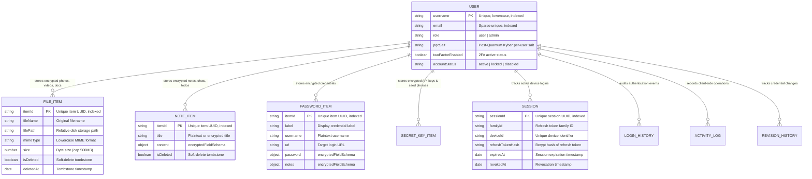

# 🗄️ Database Data Models & Schema Architecture (`doc/database-schemas.md`)

This document provides a technical reference for all Mongoose models, document schemas, subdocument structures, indexing strategies, validation constraints, and encryption storage patterns implemented in **Vault**.

---

## 1. Architectural Philosophy & Storage Model

Vault stores user data in **MongoDB Atlas** using a single-user partitioned document model augmented with specialized encrypted subdocument collections.



---

## 2. Encrypted Field Schema (`encryptedFieldSchema`)

The atomic building block of all encrypted records is the `encryptedFieldSchema` (`server/models/user.ts`):

```typescript
const encryptedFieldSchema = new mongoose.Schema(
  {
    cipherText: { type: String, required: true },
    iv: { type: String, required: true },
    authTag: { type: String, required: true },
    algorithm: {
      type: String,
      enum: ['aes-256-gcm'],
      default: 'aes-256-gcm',
    },
    salt: { type: String, default: null },
    keyVersion: { type: String, default: 'v1' },
  },
  { _id: false, versionKey: false },
);
```

### Field Specifications:
- **`cipherText`**: Base64-encoded encrypted payload.
- **`iv`**: Base64-encoded 96-bit (12-byte) initialization vector generated freshly per record.
- **`authTag`**: Base64-encoded 128-bit (16-byte) Galois/Counter Mode authentication tag.
- **`algorithm`**: Standardized cryptographic cipher (`aes-256-gcm`).
- **`salt`**: Optional per-item derivation salt for key-isolated records.
- **`keyVersion`**: Tracks key generation epoch to facilitate seamless zero-downtime key rotation (`v1`, `v2`, etc.).

---

## 3. Vault Item Schemas

All item schemas incorporate common timestamp and soft-delete fields:
- `createdAt`: Immutable UTC timestamp (`Date.now`).
- `updatedAt`: Mutable UTC timestamp modified on every update.
- `isDeleted`: Boolean flag marking soft-deleted records.
- `deletedAt`: UTC timestamp indicating when the item was soft-deleted for tombstone delta synchronization.

---

### 3.1 File Item Schema (`fileItemSchema`)

Stores encrypted photos, videos, audio tracks, PDFs, and general document files:

| Field | Type | Rules & Constraints | Purpose |
| :---- | :--- | :------------------ | :------ |
| **`itemId`** | `String` | Required, Indexed | Unique client UUID for the file. |
| **`fileName`** | `String` | Required, Trimmed | Sanitized original filename. |
| **`filePath`** | `String` | Required | Internal relative path under `uploads/<userId>/`. |
| **`mimeType`** | `String` | Required, Lowercase | Validated MIME type string (e.g., `image/jpeg`). |
| **`size`** | `Number` | Min: 1, Max: 524,288,000 (500 MB) | Physical file byte size. |
| **`isDeleted`**| `Boolean`| Default: `false`, Indexed | Tombstone marker for delta synchronization. |
| **`deletedAt`**| `Date` | Default: `null`, Indexed | Deletion timestamp for tombstone propagation. |

---

### 3.2 Note Item Schema (`noteSchema`)

Used for encrypted rich text notes, private chats, tasks/todos, saved locations, and contacts:

| Field | Type | Rules & Constraints | Purpose |
| :---- | :--- | :------------------ | :------ |
| **`itemId`** | `String` | Required, Indexed | Unique item UUID. |
| **`title`** | `String` | Required, Max: 200 chars | Display title. |
| **`content`** | `encryptedFieldSchema` | Required | Encrypted ProseMirror JSON or Markdown document. |
| **`isDeleted`**| `Boolean`| Default: `false`, Indexed | Tombstone sync marker. |
| **`deletedAt`**| `Date` | Default: `null`, Indexed | Deletion timestamp. |

---

### 3.3 Password Credential Schema (`passwordSchema`)

Stores credentials, login passwords, and encrypted account notes:

| Field | Type | Rules & Constraints | Purpose |
| :---- | :--- | :------------------ | :------ |
| **`itemId`** | `String` | Required, Indexed | Unique credential UUID. |
| **`label`** | `String` | Required, Trimmed | Service/Application name (e.g., "GitHub Personal"). |
| **`username`** | `String` | Default: `""` | Account username or email. |
| **`url`** | `String` | Default: `""` | Service login URL. |
| **`password`** | `encryptedFieldSchema` | Required | AES-256-GCM encrypted password string. |
| **`notes`** | `encryptedFieldSchema` | Default: `null` | Encrypted recovery codes or security questions. |

---

### 3.4 Secret Key Schema (`secretKeySchema`)

Dedicated storage for cryptocurrency seed phrases, API private keys, and recovery mnemonics:

| Field | Type | Rules & Constraints | Purpose |
| :---- | :--- | :------------------ | :------ |
| **`itemId`** | `String` | Required, Indexed | Unique secret identifier. |
| **`label`** | `String` | Required, Trimmed | Wallet or service label. |
| **`value`** | `encryptedFieldSchema` | Required | Encrypted mnemonic phrase or private key string. |
| **`description`**| `String` | Default: `""` | Optional usage notes or blockchain network. |

---

## 4. Session & Authentication Schemas

### 4.1 Device Session Schema (`sessionSchema`)

Vault implements **Token Family Tracking (RFC 6819)** to detect and isolate token replay attacks:

```typescript
const sessionSchema = new mongoose.Schema(
  {
    sessionId: { type: String, required: true, index: true },
    familyId: { type: String, default: null, index: true },
    deviceId: { type: String, required: true },
    deviceName: { type: String, default: '' },
    refreshTokenHash: { type: String, required: true, select: false },
    createdAt: { type: Date, default: Date.now },
    lastUsedAt: { type: Date, default: Date.now },
    lastRotatedAt: { type: Date, default: Date.now },
    expiresAt: { type: Date, required: true, index: true },
    revokedAt: { type: Date, default: null },
    ipAddress: { type: String, default: 'unknown' },
    userAgent: { type: String, default: 'unknown' },
    loginMethod: {
      type: String,
      enum: ['password', 'refresh', 'unknown'],
      default: 'password',
    },
  },
  { _id: false, versionKey: false },
);
```

#### Token Family Invalidation:
- When an access token is refreshed, the server rotates the refresh token within the same `familyId`.
- If an adversary intercepts a previously used refresh token and attempts to redeem it, the server detects a replay attack, immediately marks all sessions sharing that `familyId` as `revokedAt: new Date()`, zeroizes active socket connections, and forces all involved devices to log out.

---

### 4.2 Login History & Security Telemetry

Every authentication attempt is logged under `loginHistorySchema`:
- **`status`**: `'SUCCESS'` or `'FAILED'`.
- **`errorCode`** & **`failureReason`**: Captured during brute-force detection or invalid passphrase attempts.
- **`ipAddress`** & **`userAgent`**: Bound to device telemetry to identify geographical anomalies.

---

## 5. Main User Schema (`User`)

The master user record orchestrates all subdocuments into a unified document:

```typescript
const userSchema = new mongoose.Schema({
  username: {
    type: String,
    required: true,
    unique: true,
    lowercase: true,
    minlength: 3,
    maxlength: 64,
    match: /^[a-z0-9._@+-]+$/,
    index: true,
  },
  email: { type: String, unique: true, sparse: true, lowercase: true, index: true },
  role: { type: String, enum: ['user', 'admin'], default: 'user' },
  password: { type: mongoose.Schema.Types.Mixed, required: true, select: false },
  masterKey: { type: encryptedFieldSchema, required: true, select: false },
  pqcSalt: { type: String, default: null },
  twoFactorEnabled: { type: Boolean, default: false },
  twoFactorSecret: { type: encryptedFieldSchema, default: null, select: false },
  twoFactorBackupCodes: { type: [String], default: [] },
  vault: {
    photos: [fileItemSchema],
    videos: [fileItemSchema],
    audios: [fileItemSchema],
    documents: [fileItemSchema],
    otherFiles: [fileItemSchema],
    notes: [noteSchema],
    chats: [noteSchema],
    todos: [noteSchema],
    passwords: [passwordSchema],
    secretKeys: [secretKeySchema],
    location: [noteSchema],
    contact: [noteSchema],
  },
  sessions: [sessionSchema],
  loginHistory: [loginHistorySchema],
  activityLog: [activityLogSchema],
});
```

---

## 6. Indexing & Query Optimization Strategy

To ensure sub-5ms database queries under high concurrency:

1. **Unique Indices**:
   - `{ username: 1 }` (unique, lowercase).
   - `{ email: 1 }` (sparse unique index allowing unverified email accounts).
2. **Compound Subdocument Indices**:
   - `{ "sessions.sessionId": 1 }` for rapid JWT session validation.
   - `{ "sessions.expiresAt": 1 }` for automated TTL session cleanups.
   - `{ "vault.notes.itemId": 1 }`, `{ "vault.passwords.itemId": 1 }`, `{ "vault.photos.itemId": 1 }` for constant-time $O(1)$ item lookups.
3. **Soft-Delete Sync Indices**:
   - `{ "vault.notes.updatedAt": 1, "vault.notes.isDeleted": 1 }` for efficient delta queries (`/api/vault/sync?since=...`).
