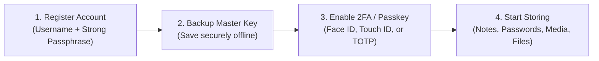
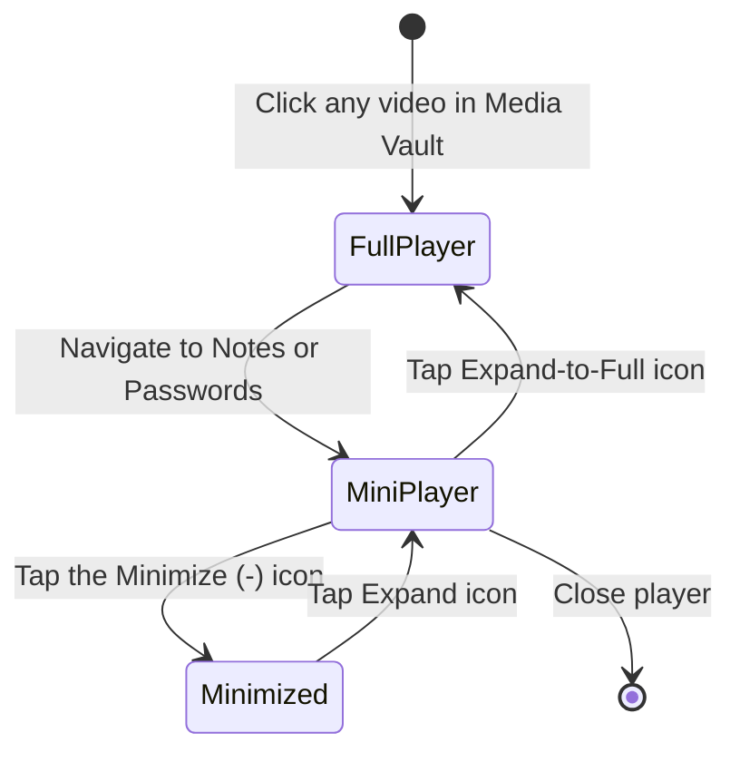

# 📖 User-Friendly Handbook & Everyday Guide (`doc/user-guide.md`)

Welcome to **Vault**! This guide is written in clear, simple terms to help you master your encrypted personal locker, protect your privacy, and use all of Vault's features effortlessly across desktop and mobile devices.

---

## 1. What is Vault? (In Plain English)

Traditional cloud storage platforms (Google Drive, Dropbox, iCloud) store your files and passwords in a format they can decrypt. If their servers are breached, rogue employees go snooping, or governments demand access, your private data can be read.

**Vault is completely different**:
- **Zero-Knowledge Privacy**: Your photos, videos, confidential notes, passwords, and PDF documents are encrypted on your device **before** they are sent to the cloud.
- **You Hold the Only Key**: Only your master passphrase can unlock your data. Even the system administrator, database hosting providers, or cloud servers see only scrambled random characters.
- **Real-Time Cross-Device Sync**: Any change you make on your phone or laptop instantly syncs across all your connected devices in real time.

---

## 2. Getting Started: Account Setup & First Steps



### 2.1 The Golden Rule of Zero-Knowledge: Protect Your Passphrase!
> [!CAUTION]
> **There is NO "Forgot Password" Link!**
> Because Vault is 100% Zero-Knowledge, the server **never** stores your master passphrase. If you lose your passphrase, no one on Earth can decrypt your data. Store your passphrase in a physically secure place or safe notebook!

### 2.2 Adding Extra Protection: Passkeys & Two-Factor Authentication (2FA)
1. Go to **Settings** $\rightarrow$ **Security & 2FA**.
2. **Biometric Passkeys (Recommended)**: Click **Add Passkey** to sign in using **Face ID**, **Touch ID**, or **Windows Hello** — fast, seamless, and completely immune to phishing attacks.
3. **Authenticator App (TOTP)**: Click **Enable 2FA**, scan the QR code using Google Authenticator, Authy, or 1Password, and save the 6 backup recovery codes.

---

## 3. Daily Usage: Exploring the Core Vaults

Vault organizes your digital life into specialized encrypted compartments:

```
+-----------------------------------------------------------------------------------+
|  📝 Notes Vault      - Rich text formatting, checklists, Markdown & autosaving    |
|  📷 Photos & Media   - Encrypted photo gallery, EXIF stripping & lightbox viewer  |
|  🎬 Video Player     - Floating Picture-in-Picture mini-player with filters       |
|  🔑 Password Manager - Secure credential vault, password generator & OTP tokens   |
|  📄 Document Shield  - PDF viewer with tab-switch blurring & anti-screenshot      |
+-----------------------------------------------------------------------------------+
```

---

### 📝 3.1 Notes Vault: Rich Text & Markdown Editing

Write daily journals, confidential thoughts, meeting notes, or project tasks using the built-in **TipTap** editor:
- **Instant Markdown Shortcuts**:
  - Type `# ` for Large Heading.
  - Type `## ` for Sub-Heading.
  - Type `- [ ] ` to create an interactive To-Do Checklist.
  - Type `> ` to format a blockquote.
  - Type `***` or `---` to insert a horizontal divider.
- **Automatic Saving**: Notes autosave 300ms after you stop typing. No need to click "Save"!
- **Local Decryption**: Your notes decrypt instantly on your device so browsing feels instantaneous even on slow networks.

---

### 📷 3.2 Photos & Media Vault

Safely archive private family photos, identification scans, and personal memories:
- **Automatic EXIF Stripping**: When enabled in Settings, Vault automatically strips sensitive GPS location data, camera serial numbers, and device models from photos before encryption.
- **In-Browser Decryption**: High-resolution photos are decrypted in your browser’s memory without creating temporary unencrypted cache files on your hard drive.
- **Live Camera Capture**: Tap the Camera icon to capture encrypted photos or audio memos directly into your vault without leaving traces in your phone's default camera roll.

---

### 🎬 3.3 Floating Video Mini-Player (Picture-in-Picture)

Watch encrypted videos, tutorials, or voice memos without interrupting your work:



- **Floating Convenience**: When you browse away from the media tab, the video detaches into a floating window in the bottom-right corner.
- **Picture-in-Picture (PiP)**: Supports browser native Picture-in-Picture to keep playing outside the browser window.
- **Live Visual Filters**: Need to enhance a dark recording? Open the player settings to apply **Contrast Boost**, **Night Vision**, or **Grayscale** filters on-the-fly.

---

### 🔑 3.4 Password Manager & Credential Locker

Store all your website logins and security credentials securely:
- **Built-in Password Generator**: Generate high-entropy passwords (16 to 64 characters) with custom symbols, numbers, and uppercase rules.
- **One-Click Copy with Auto-Clear**: Click the copy icon next to any password. For security, your clipboard automatically purges the password after 30 seconds to prevent clipboard theft.
- **Built-in TOTP Authenticator**: Scan 2FA QR codes from other websites directly into Vault. Vault generates live 6-digit codes with animated 30-second countdown rings.

---

### 📄 3.5 Document & Mobile PDF Privacy Shield

When viewing confidential PDFs (passports, tax filings, legal contracts), Vault guards you against shoulder surfing:
- **Tab-Switch Blurring**: The moment you switch browser tabs or minimize your window, the PDF viewer instantly applies a **heavy 30px blur** and black shield. Operating system previews (like the Windows Taskbar or iOS App Switcher) will never capture a thumbnail of your sensitive document.
- **Anti-Screenshot Deterrence**: Displays a dynamic, subtle watermark containing your username and IP address.
- **Print Protection**: Suppresses accidental `Ctrl+P` print attempts.

---

## 4. Mobile & Touch-Friendly Features

Vault is designed to work like a native app on iOS Safari and Android Chrome:

### 4.1 Touch Drag-and-Drop Polyfill
- **200ms Hold-to-Pick**: On mobile screens, press and hold any item for 200 milliseconds. Your phone will give a **subtle vibrational haptic buzz**, indicating the file is picked up.
- **Quick-Drop Bar**: A mobile-optimized bottom bar will slide up, allowing you to drop files into folders without hunting through tiny sidebar trees.
- **Safe-Area Padding**: Drop targets automatically avoid bottom gesture home bars on modern iPhones and Android displays.

### 4.2 Install as PWA (Add to Home Screen)
- **iPhone (iOS Safari)**: Tap the **Share** button $\rightarrow$ tap **Add to Home Screen**.
- **Android (Chrome)**: Tap the **three-dots menu** $\rightarrow$ tap **Install App** or **Add to Home screen**.
- Vault will launch in full-screen standalone mode with no browser URL bars.

---

## 5. Security & Privacy Shortcuts Cheat Sheet

| Action | Windows / Linux | macOS | Description |
| :----- | :-------------- | :---- | :---------- |
| **Quick Search / Command Palette** | `Ctrl + K` | `Cmd + K` | Open search to find notes, files, or settings instantly. |
| **Create New Item** | `Ctrl + N` | `Cmd + N` | Open quick creation modal for a note or password. |
| **Immediately Lock Vault** | `Ctrl + L` | `Cmd + L` | Locks the vault and wipes keys from memory immediately. |
| **Universal Emergency Panic Lock** | `Ctrl + Shift + L` | `Cmd + Shift + L` | Emergency wipe: shred all keys within 60ms and logout. |
| **Copy Password / Content** | `Ctrl + C` | `Cmd + C` | Secure copy with automated clipboard purge. |
| **Delete / Trash Highlighted Item**| `Delete` | `Backspace` | Move selected vault item to trash. |
| **Next / Previous Item** | `←` / `→` | `←` / `→` | Navigate between items in galleries or lists. |

---

## 6. Advanced Privacy: Decoy Vault & Duress Defense

### What is the Decoy Vault?
If you are ever in a situation where someone (such as an attacker, border inspector, or coercive individual) forces you to unlock your vault:
1. Go to **Settings** $\rightarrow$ **Security Preferences** $\rightarrow$ enable **Decoy Vault Partition**.
2. Set a distinct secondary **Decoy PIN**.
3. **How it works under duress**:
   - If you enter your **Master Passphrase**, your true personal vault unlocks.
   - If you enter your **Decoy PIN**, a completely authentic-looking decoy vault unlocks with realistic placeholder items!
   - There are **zero clues, error messages, or network signs** that another vault exists.

---

## 7. Frequently Asked Questions (FAQ)

### Q1: Can the website creator or server administrator see my files?
**No, never.** All encryption and decryption happen strictly inside your browser using AES-256-GCM. The server only receives encrypted ciphertexts that look like scrambled noise.

### Q2: What happens if my internet disconnects while I am working?
**You can keep working seamlessly!** Vault is offline-first. Your decrypted notes and files stay accessible in your browser's local encrypted storage (`IndexedDB`). When you reconnect, Vault automatically syncs your changes to the cloud.

### Q3: Why does Vault lock automatically after a minute of inactivity?
To protect your data if you walk away from your desk! If no mouse movement, touch, or keystroke is detected for 60 seconds, Vault purges all encryption keys from computer memory. You can adjust the auto-lock timeout in **Settings**.

### Q4: How do I export or backup my data?
Go to **Settings** $\rightarrow$ **Backup & Export**. You can export an encrypted JSON vault backup to store on an external USB drive or offline storage.
